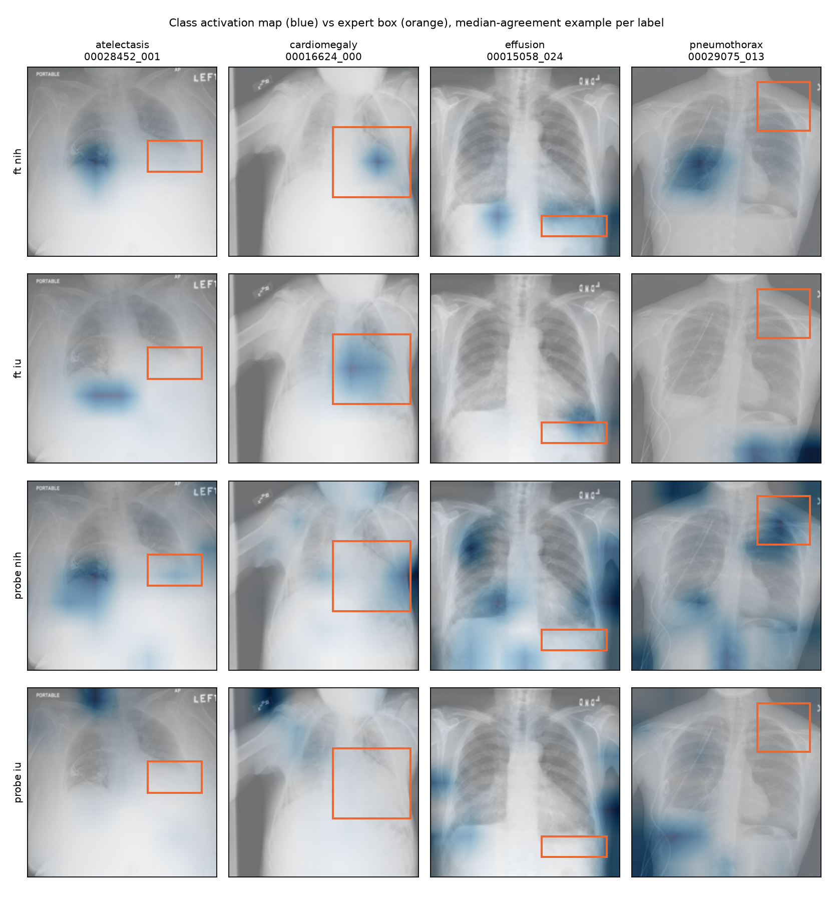

# Class activation maps vs expert bounding boxes (NIH test split)

576 boxes on 549 images for atelectasis, cardiomegaly, effusion, pneumothorax (1 boxes dropped by the centre crop). Pointing game = map maximum inside the box; energy = fraction of map mass inside the box; chance = what a uniform map scores on both (box area fraction); IoU@0.5 = overlap of the box with the map thresholded at half its maximum. Brackets are 95% patient-level bootstrap intervals; all models are scored on the same boxes and resamples.

## ft_nih: fine-tuned ResNet-50, trained on NIH (in-domain)

| label | n | pointing game | energy inside | chance | IoU@0.5 |
|---|---|---|---|---|---|
| all | 576 | 0.445 [0.402, 0.492] | 0.345 [0.313, 0.378] | 0.108 | 0.133 |
| atelectasis | 180 | 0.325 [0.256, 0.392] | 0.193 [0.162, 0.224] | 0.043 | 0.134 |
| cardiomegaly | 146 | 0.934 [0.898, 0.970] | 0.825 [0.793, 0.858] | 0.233 | 0.181 |
| effusion | 153 | 0.340 [0.263, 0.426] | 0.214 [0.183, 0.251] | 0.090 | 0.150 |
| pneumothorax | 97 | 0.097 [0.046, 0.156] | 0.109 [0.076, 0.148] | 0.070 | 0.032 |

## ft_iu: fine-tuned ResNet-50, trained on IU (cross-hospital)

| label | n | pointing game | energy inside | chance | IoU@0.5 |
|---|---|---|---|---|---|
| all | 576 | 0.339 [0.296, 0.384] | 0.275 [0.243, 0.307] | 0.108 | 0.098 |
| atelectasis | 180 | 0.111 [0.069, 0.159] | 0.080 [0.062, 0.101] | 0.043 | 0.048 |
| cardiomegaly | 146 | 0.890 [0.837, 0.937] | 0.732 [0.692, 0.766] | 0.233 | 0.219 |
| effusion | 153 | 0.255 [0.186, 0.324] | 0.188 [0.161, 0.217] | 0.090 | 0.093 |
| pneumothorax | 97 | 0.067 [0.016, 0.127] | 0.085 [0.047, 0.133] | 0.070 | 0.016 |

## probe_nih: frozen ImageNet ResNet-50 + NIH probe (in-domain)

| label | n | pointing game | energy inside | chance | IoU@0.5 |
|---|---|---|---|---|---|
| all | 576 | 0.222 [0.187, 0.258] | 0.157 [0.141, 0.171] | 0.108 | 0.088 |
| atelectasis | 180 | 0.100 [0.058, 0.144] | 0.066 [0.057, 0.077] | 0.043 | 0.057 |
| cardiomegaly | 146 | 0.466 [0.383, 0.549] | 0.355 [0.331, 0.379] | 0.233 | 0.159 |
| effusion | 153 | 0.190 [0.128, 0.250] | 0.122 [0.106, 0.139] | 0.090 | 0.090 |
| pneumothorax | 97 | 0.134 [0.071, 0.209] | 0.080 [0.060, 0.104] | 0.070 | 0.038 |

## probe_iu: frozen ImageNet ResNet-50 + IU probe (cross-hospital)

| label | n | pointing game | energy inside | chance | IoU@0.5 |
|---|---|---|---|---|---|
| all | 576 | 0.160 [0.130, 0.192] | 0.134 [0.120, 0.148] | 0.108 | 0.048 |
| atelectasis | 180 | 0.067 [0.034, 0.105] | 0.054 [0.045, 0.066] | 0.043 | 0.028 |
| cardiomegaly | 146 | 0.322 [0.240, 0.403] | 0.284 [0.253, 0.313] | 0.233 | 0.064 |
| effusion | 153 | 0.170 [0.110, 0.232] | 0.122 [0.105, 0.142] | 0.090 | 0.068 |
| pneumothorax | 97 | 0.072 [0.028, 0.124] | 0.075 [0.057, 0.096] | 0.070 | 0.027 |

## Paired differences (all boxes)

| contrast | pointing game | energy inside |
|---|---|---|
| ft_nih - probe_nih | 0.223 [0.178, 0.269] | 0.188 [0.167, 0.211] |
| ft_iu - probe_iu | 0.180 [0.136, 0.225] | 0.141 [0.117, 0.165] |
| ft_iu - ft_nih | -0.105 [-0.144, -0.069] | -0.070 [-0.090, -0.052] |
| probe_iu - probe_nih | -0.062 [-0.099, -0.026] | -0.023 [-0.031, -0.014] |

## Examples

