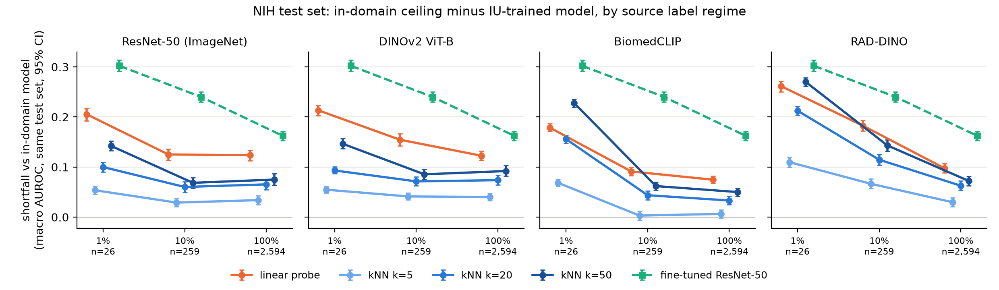
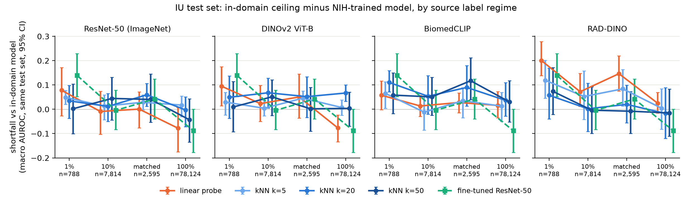
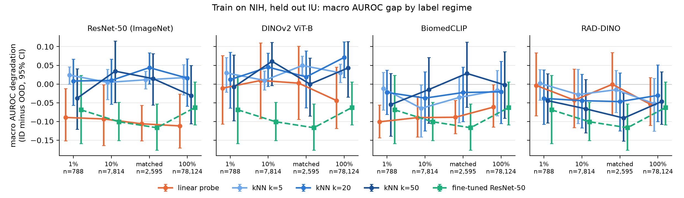
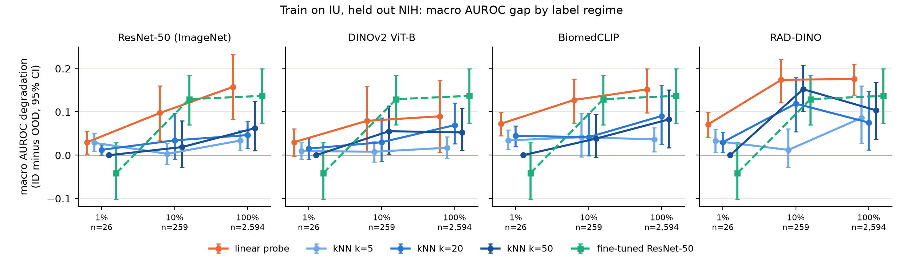
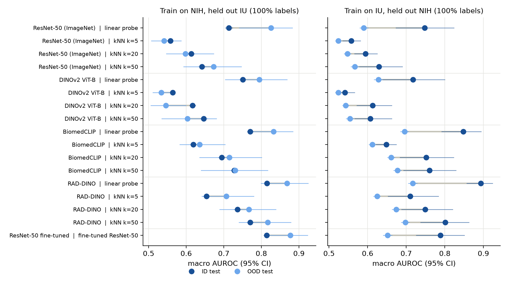

# Results: frozen encoders with linear probe or kNN retrieval vs a fine-tuned CNN, across hospitals

ID = the training dataset's patient-level test split; OOD = the other dataset's test split. Macro = mean over the five pathologies (no_finding reported per label only). gap = ID - OOD for AUROC and AUPRC and OOD - ID for ECE, so positive is always degradation. Brackets are 95% patient-level bootstrap intervals (1,000 resamples, the same resampled patients for every run). Point estimates are the seed-0 training subset; 'gap sd (seeds)' is the standard deviation of the point gap over three subsets. 'matched' trains NIH on as many images as IU's full training split. These are research measurements on public data; no clinical utility is claimed.

Frozen-head runs: 68. Probe C grid [np.float64(0.0001), np.float64(0.001), np.float64(0.01), np.float64(0.1), np.float64(1.0)]; 8 runs fell back to the default C because validation had no positives (1pct). kNN k is clipped to the index size where the training subset is smaller than k (min k_eff50 = 26.0).

Fine-tuned ResNet-50 runs: 17 (ImageNet init, all layers, BCE, AdamW lr 0.0001, batch 64, early stopping on validation macro AUROC). Best epoch / epochs run per run: iu_1pct_s0: 1/4, nih_100pct_s0: 3/6, iu_1pct_s1: 40/40, iu_1pct_s2: 28/31, iu_10pct_s0: 4/7, iu_10pct_s1: 2/5, iu_10pct_s2: 5/8, iu_100pct_s0: 5/8, nih_1pct_s0: 4/7, nih_matched_s0: 5/8, nih_10pct_s0: 5/8, nih_1pct_s1: 6/9, nih_1pct_s2: 5/8, nih_matched_s1: 2/5, nih_matched_s2: 3/6, nih_10pct_s1: 4/7, nih_10pct_s2: 3/6.

## Same-test-set transfer gap (primary)

The ID-vs-OOD gap below compares one model on two different test sets, so it also measures how hard each benchmark is: the IU test split (manual MeSH labels, mostly normal studies) is easier than the NIH official test split (NLP-mined labels, skewed towards pathology), and most NIH-trained models score higher on IU than on NIH. The transfer gap fixes the test set instead: on the target's test split, the in-domain model (trained on the target, 100% labels) minus the source-trained model at each label regime. Positive means the transferred model falls short of the in-domain ceiling. Both models are evaluated on the same bootstrap resamples, so the CI is paired.

### Target NIH test set, source IU

Macro AUROC of the transferred model on the target test set, with the gap to the in-domain ceiling in brackets.

| encoder | head | in-domain ceiling | 1% (n=26) | 10% (n=259) | 100% (n=2,594) |
|---|---|---|---|---|---|
| ResNet-50 (ImageNet) | linear probe | 0.714 | 0.508 (gap 0.205 [0.192, 0.217]) | 0.589 (gap 0.125 [0.114, 0.136]) | 0.590 (gap 0.124 [0.113, 0.134]) |
| ResNet-50 (ImageNet) | kNN k=5 | 0.558 | 0.504 (gap 0.054 [0.046, 0.061]) | 0.529 (gap 0.029 [0.021, 0.037]) | 0.524 (gap 0.034 [0.025, 0.043]) |
| ResNet-50 (ImageNet) | kNN k=20 | 0.614 | 0.513 (gap 0.100 [0.090, 0.110]) | 0.553 (gap 0.060 [0.049, 0.071]) | 0.548 (gap 0.065 [0.055, 0.076]) |
| ResNet-50 (ImageNet) | kNN k=50 | 0.642 | 0.500 (gap 0.142 [0.133, 0.152]) | 0.574 (gap 0.069 [0.058, 0.079]) | 0.567 (gap 0.075 [0.063, 0.087]) |
| DINOv2 ViT-B | linear probe | 0.750 | 0.537 (gap 0.213 [0.203, 0.223]) | 0.596 (gap 0.155 [0.143, 0.167]) | 0.628 (gap 0.123 [0.114, 0.132]) |
| DINOv2 ViT-B | kNN k=5 | 0.564 | 0.509 (gap 0.055 [0.049, 0.061]) | 0.523 (gap 0.041 [0.034, 0.049]) | 0.524 (gap 0.040 [0.033, 0.048]) |
| DINOv2 ViT-B | kNN k=20 | 0.617 | 0.524 (gap 0.093 [0.087, 0.100]) | 0.546 (gap 0.071 [0.063, 0.081]) | 0.543 (gap 0.074 [0.064, 0.083]) |
| DINOv2 ViT-B | kNN k=50 | 0.646 | 0.500 (gap 0.146 [0.137, 0.157]) | 0.561 (gap 0.085 [0.075, 0.096]) | 0.554 (gap 0.092 [0.082, 0.103]) |
| BiomedCLIP | linear probe | 0.771 | 0.592 (gap 0.179 [0.171, 0.187]) | 0.679 (gap 0.091 [0.083, 0.099]) | 0.696 (gap 0.075 [0.067, 0.082]) |
| BiomedCLIP | kNN k=5 | 0.619 | 0.550 (gap 0.069 [0.061, 0.076]) | 0.616 (gap 0.003 [-0.006, 0.012]) | 0.612 (gap 0.006 [-0.002, 0.014]) |
| BiomedCLIP | kNN k=20 | 0.694 | 0.538 (gap 0.156 [0.147, 0.164]) | 0.651 (gap 0.044 [0.034, 0.053]) | 0.661 (gap 0.033 [0.025, 0.042]) |
| BiomedCLIP | kNN k=50 | 0.728 | 0.500 (gap 0.228 [0.219, 0.236]) | 0.666 (gap 0.062 [0.054, 0.070]) | 0.678 (gap 0.050 [0.042, 0.058]) |
| RAD-DINO | linear probe | 0.815 | 0.553 (gap 0.261 [0.250, 0.271]) | 0.632 (gap 0.183 [0.172, 0.193]) | 0.717 (gap 0.098 [0.088, 0.107]) |
| RAD-DINO | kNN k=5 | 0.654 | 0.544 (gap 0.110 [0.100, 0.119]) | 0.588 (gap 0.067 [0.057, 0.076]) | 0.625 (gap 0.030 [0.021, 0.039]) |
| RAD-DINO | kNN k=20 | 0.737 | 0.524 (gap 0.213 [0.204, 0.222]) | 0.622 (gap 0.115 [0.104, 0.125]) | 0.674 (gap 0.063 [0.053, 0.073]) |
| RAD-DINO | kNN k=50 | 0.770 | 0.500 (gap 0.270 [0.261, 0.278]) | 0.627 (gap 0.143 [0.131, 0.154]) | 0.698 (gap 0.072 [0.063, 0.081]) |
| ResNet-50 fine-tuned | fine-tuned ResNet-50 | 0.814 | 0.512 (gap 0.302 [0.291, 0.314]) | 0.574 (gap 0.240 [0.230, 0.250]) | 0.651 (gap 0.162 [0.153, 0.171]) |

Paired contrasts of the transfer gap. 'probe - kNN' positive means the probe loses more of its in-domain ceiling than retrieval; 'fine-tuned - X' positive means the fine-tuned ResNet-50 loses more than frozen head X.

| encoder | regime | probe - kNN k=5 | probe - kNN k=20 | probe - kNN k=50 | fine-tuned - linear probe | fine-tuned - kNN k=50 |
|---|---|---|---|---|---|---|
| ResNet-50 (ImageNet) | 1% | 0.152 [0.141, 0.161] | 0.105 [0.094, 0.115] | 0.063 [0.053, 0.072] | 0.097 [0.083, 0.112] | 0.160 [0.148, 0.174] |
| DINOv2 ViT-B | 1% | 0.159 [0.149, 0.168] | 0.120 [0.110, 0.130] | 0.067 [0.055, 0.079] | 0.089 [0.075, 0.103] | 0.156 [0.142, 0.170] |
| BiomedCLIP | 1% | 0.110 [0.102, 0.118] | 0.023 [0.014, 0.033] | -0.049 [-0.059, -0.038] | 0.123 [0.111, 0.136] | 0.074 [0.064, 0.086] |
| RAD-DINO | 1% | 0.152 [0.144, 0.160] | 0.049 [0.040, 0.057] | -0.009 [-0.019, 0.001] | 0.041 [0.029, 0.054] | 0.032 [0.021, 0.043] |
| ResNet-50 (ImageNet) | 10% | 0.096 [0.083, 0.109] | 0.065 [0.054, 0.076] | 0.057 [0.047, 0.066] | 0.115 [0.100, 0.129] | 0.172 [0.158, 0.186] |
| DINOv2 ViT-B | 10% | 0.113 [0.102, 0.125] | 0.083 [0.072, 0.094] | 0.069 [0.059, 0.078] | 0.086 [0.074, 0.097] | 0.155 [0.142, 0.169] |
| BiomedCLIP | 10% | 0.088 [0.080, 0.097] | 0.047 [0.040, 0.055] | 0.029 [0.023, 0.035] | 0.149 [0.138, 0.160] | 0.178 [0.167, 0.190] |
| RAD-DINO | 10% | 0.116 [0.106, 0.127] | 0.068 [0.060, 0.076] | 0.039 [0.031, 0.047] | 0.057 [0.042, 0.072] | 0.097 [0.081, 0.112] |
| ResNet-50 (ImageNet) | 100% | 0.090 [0.079, 0.099] | 0.058 [0.048, 0.068] | 0.049 [0.039, 0.058] | 0.039 [0.028, 0.050] | 0.087 [0.074, 0.101] |
| DINOv2 ViT-B | 100% | 0.082 [0.072, 0.092] | 0.049 [0.038, 0.058] | 0.031 [0.021, 0.040] | 0.040 [0.031, 0.048] | 0.070 [0.058, 0.082] |
| BiomedCLIP | 100% | 0.068 [0.059, 0.077] | 0.041 [0.034, 0.049] | 0.025 [0.018, 0.031] | 0.088 [0.079, 0.096] | 0.112 [0.103, 0.121] |
| RAD-DINO | 100% | 0.068 [0.058, 0.079] | 0.035 [0.026, 0.045] | 0.025 [0.017, 0.033] | 0.065 [0.052, 0.077] | 0.090 [0.078, 0.101] |

### Target IU test set, source NIH

Macro AUROC of the transferred model on the target test set, with the gap to the in-domain ceiling in brackets.

| encoder | head | in-domain ceiling | 1% (n=788) | 10% (n=7,814) | matched (n=2,595) | 100% (n=78,124) |
|---|---|---|---|---|---|---|
| ResNet-50 (ImageNet) | linear probe | 0.748 | 0.670 (gap 0.078 [-0.027, 0.172]) | 0.757 (gap -0.009 [-0.103, 0.074]) | 0.747 (gap 0.001 [-0.077, 0.072]) | 0.826 (gap -0.078 [-0.176, 0.007]) |
| ResNet-50 (ImageNet) | kNN k=5 | 0.558 | 0.509 (gap 0.049 [0.020, 0.078]) | 0.545 (gap 0.013 [-0.043, 0.059]) | 0.529 (gap 0.029 [-0.001, 0.058]) | 0.541 (gap 0.017 [-0.031, 0.054]) |
| ResNet-50 (ImageNet) | kNN k=20 | 0.595 | 0.560 (gap 0.034 [-0.037, 0.098]) | 0.583 (gap 0.012 [-0.050, 0.064]) | 0.535 (gap 0.059 [0.011, 0.106]) | 0.598 (gap -0.003 [-0.072, 0.051]) |
| ResNet-50 (ImageNet) | kNN k=50 | 0.629 | 0.627 (gap 0.002 [-0.101, 0.104]) | 0.585 (gap 0.044 [-0.045, 0.131]) | 0.589 (gap 0.040 [-0.053, 0.145]) | 0.673 (gap -0.044 [-0.135, 0.043]) |
| DINOv2 ViT-B | linear probe | 0.718 | 0.623 (gap 0.095 [0.014, 0.175]) | 0.695 (gap 0.023 [-0.050, 0.098]) | 0.667 (gap 0.050 [-0.036, 0.145]) | 0.795 (gap -0.077 [-0.134, -0.024]) |
| DINOv2 ViT-B | kNN k=5 | 0.541 | 0.512 (gap 0.029 [-0.023, 0.069]) | 0.537 (gap 0.004 [-0.028, 0.037]) | 0.496 (gap 0.046 [0.013, 0.076]) | 0.534 (gap 0.007 [-0.025, 0.039]) |
| DINOv2 ViT-B | kNN k=20 | 0.613 | 0.564 (gap 0.049 [-0.037, 0.137]) | 0.545 (gap 0.068 [0.005, 0.128]) | 0.561 (gap 0.052 [-0.034, 0.133]) | 0.546 (gap 0.067 [0.032, 0.100]) |
| DINOv2 ViT-B | kNN k=50 | 0.607 | 0.598 (gap 0.009 [-0.092, 0.114]) | 0.556 (gap 0.051 [-0.026, 0.121]) | 0.605 (gap 0.002 [-0.090, 0.090]) | 0.604 (gap 0.004 [-0.069, 0.071]) |
| BiomedCLIP | linear probe | 0.848 | 0.790 (gap 0.058 [-0.002, 0.116]) | 0.835 (gap 0.013 [-0.030, 0.057]) | 0.820 (gap 0.028 [-0.015, 0.067]) | 0.832 (gap 0.016 [-0.036, 0.072]) |
| BiomedCLIP | kNN k=5 | 0.649 | 0.584 (gap 0.065 [0.003, 0.113]) | 0.660 (gap -0.012 [-0.086, 0.054]) | 0.614 (gap 0.035 [-0.035, 0.089]) | 0.636 (gap 0.013 [-0.050, 0.069]) |
| BiomedCLIP | kNN k=20 | 0.752 | 0.641 (gap 0.110 [0.071, 0.158]) | 0.698 (gap 0.053 [-0.021, 0.138]) | 0.662 (gap 0.090 [0.013, 0.179]) | 0.715 (gap 0.037 [-0.028, 0.109]) |
| BiomedCLIP | kNN k=50 | 0.760 | 0.702 (gap 0.058 [-0.018, 0.149]) | 0.710 (gap 0.051 [-0.024, 0.131]) | 0.643 (gap 0.117 [0.040, 0.212]) | 0.730 (gap 0.030 [-0.053, 0.117]) |
| RAD-DINO | linear probe | 0.893 | 0.693 (gap 0.200 [0.138, 0.278]) | 0.821 (gap 0.072 [0.011, 0.147]) | 0.747 (gap 0.146 [0.075, 0.220]) | 0.869 (gap 0.025 [-0.016, 0.070]) |
| RAD-DINO | kNN k=5 | 0.711 | 0.591 (gap 0.119 [0.045, 0.202]) | 0.658 (gap 0.052 [-0.043, 0.158]) | 0.627 (gap 0.084 [0.013, 0.163]) | 0.707 (gap 0.004 [-0.082, 0.084]) |
| RAD-DINO | kNN k=20 | 0.750 | 0.692 (gap 0.058 [-0.040, 0.169]) | 0.748 (gap 0.002 [-0.091, 0.107]) | 0.730 (gap 0.020 [-0.056, 0.099]) | 0.767 (gap -0.017 [-0.120, 0.088]) |
| RAD-DINO | kNN k=50 | 0.801 | 0.728 (gap 0.073 [-0.022, 0.171]) | 0.805 (gap -0.004 [-0.100, 0.092]) | 0.809 (gap -0.008 [-0.100, 0.073]) | 0.817 (gap -0.015 [-0.111, 0.083]) |
| ResNet-50 fine-tuned | fine-tuned ResNet-50 | 0.788 | 0.649 (gap 0.139 [0.052, 0.229]) | 0.793 (gap -0.004 [-0.083, 0.078]) | 0.746 (gap 0.042 [-0.039, 0.125]) | 0.877 (gap -0.088 [-0.177, 0.001]) |

Paired contrasts of the transfer gap. 'probe - kNN' positive means the probe loses more of its in-domain ceiling than retrieval; 'fine-tuned - X' positive means the fine-tuned ResNet-50 loses more than frozen head X.

| encoder | regime | probe - kNN k=5 | probe - kNN k=20 | probe - kNN k=50 | fine-tuned - linear probe | fine-tuned - kNN k=50 |
|---|---|---|---|---|---|---|
| ResNet-50 (ImageNet) | 1% | 0.029 [-0.078, 0.128] | 0.044 [-0.057, 0.148] | 0.076 [-0.093, 0.231] | 0.061 [-0.032, 0.164] | 0.137 [-0.002, 0.290] |
| DINOv2 ViT-B | 1% | 0.065 [-0.018, 0.143] | 0.046 [-0.061, 0.163] | 0.086 [-0.049, 0.207] | 0.044 [-0.040, 0.141] | 0.130 [-0.012, 0.277] |
| BiomedCLIP | 1% | -0.008 [-0.083, 0.074] | -0.053 [-0.125, 0.020] | -0.000 [-0.102, 0.093] | 0.082 [-0.046, 0.207] | 0.081 [-0.052, 0.209] |
| RAD-DINO | 1% | 0.081 [-0.046, 0.194] | 0.143 [0.006, 0.270] | 0.127 [-0.004, 0.238] | -0.061 [-0.197, 0.064] | 0.066 [-0.068, 0.196] |
| ResNet-50 (ImageNet) | 10% | -0.022 [-0.137, 0.073] | -0.021 [-0.123, 0.064] | -0.054 [-0.156, 0.038] | 0.005 [-0.085, 0.091] | -0.049 [-0.177, 0.063] |
| DINOv2 ViT-B | 10% | 0.019 [-0.056, 0.093] | -0.045 [-0.137, 0.044] | -0.028 [-0.124, 0.060] | -0.027 [-0.119, 0.063] | -0.055 [-0.150, 0.052] |
| BiomedCLIP | 10% | 0.025 [-0.053, 0.100] | -0.040 [-0.115, 0.036] | -0.037 [-0.100, 0.032] | -0.018 [-0.090, 0.057] | -0.055 [-0.155, 0.041] |
| RAD-DINO | 10% | 0.020 [-0.122, 0.161] | 0.070 [-0.043, 0.197] | 0.076 [-0.004, 0.165] | -0.076 [-0.163, 0.010] | -0.000 [-0.128, 0.109] |
| ResNet-50 (ImageNet) | matched | -0.028 [-0.113, 0.047] | -0.059 [-0.146, 0.014] | -0.040 [-0.176, 0.064] | 0.041 [-0.074, 0.149] | 0.002 [-0.163, 0.154] |
| DINOv2 ViT-B | matched | 0.005 [-0.088, 0.103] | -0.002 [-0.101, 0.107] | 0.049 [-0.048, 0.146] | -0.008 [-0.122, 0.085] | 0.040 [-0.076, 0.158] |
| BiomedCLIP | matched | -0.007 [-0.079, 0.074] | -0.062 [-0.153, 0.030] | -0.090 [-0.177, -0.002] | 0.014 [-0.066, 0.093] | -0.075 [-0.168, 0.023] |
| RAD-DINO | matched | 0.062 [-0.069, 0.174] | 0.126 [0.018, 0.226] | 0.154 [0.053, 0.254] | -0.104 [-0.197, -0.000] | 0.050 [-0.080, 0.170] |
| ResNet-50 (ImageNet) | 100% | -0.095 [-0.204, -0.005] | -0.075 [-0.198, 0.036] | -0.034 [-0.172, 0.084] | -0.011 [-0.078, 0.060] | -0.045 [-0.188, 0.087] |
| DINOv2 ViT-B | 100% | -0.084 [-0.150, -0.020] | -0.144 [-0.210, -0.083] | -0.080 [-0.164, 0.005] | -0.012 [-0.117, 0.093] | -0.092 [-0.210, 0.031] |
| BiomedCLIP | 100% | 0.003 [-0.080, 0.083] | -0.021 [-0.107, 0.054] | -0.014 [-0.112, 0.077] | -0.104 [-0.211, -0.000] | -0.119 [-0.205, -0.042] |
| RAD-DINO | 100% | 0.020 [-0.062, 0.098] | 0.042 [-0.045, 0.131] | 0.040 [-0.026, 0.110] | -0.113 [-0.216, -0.025] | -0.073 [-0.229, 0.047] |

## ID vs OOD side by side (as specified)

### Train on NIH, held out IU

#### Macro AUROC

| encoder | head | regime | ID | OOD | gap | gap sd (seeds) |
|---|---|---|---|---|---|---|
| ResNet-50 (ImageNet) | linear probe | 1% (n=788) | 0.581 [0.571, 0.590] | 0.670 [0.595, 0.732] | -0.089 [-0.151, -0.012] | 0.017 |
| ResNet-50 (ImageNet) | linear probe | 10% (n=7,814) | 0.664 [0.654, 0.674] | 0.757 [0.666, 0.829] | -0.093 [-0.164, -0.001] | 0.030 |
| ResNet-50 (ImageNet) | linear probe | matched (n=2,595) | 0.641 [0.631, 0.652] | 0.747 [0.699, 0.789] | -0.106 [-0.151, -0.057] | 0.018 |
| ResNet-50 (ImageNet) | linear probe | 100% (n=78,124) | 0.714 [0.704, 0.723] | 0.826 [0.741, 0.883] | -0.112 [-0.170, -0.027] |  |
| ResNet-50 (ImageNet) | kNN k=5 | 1% (n=788) | 0.533 [0.528, 0.539] | 0.509 [0.487, 0.534] | 0.024 [-0.001, 0.046] | 0.018 |
| ResNet-50 (ImageNet) | kNN k=5 | 10% (n=7,814) | 0.550 [0.544, 0.555] | 0.545 [0.510, 0.591] | 0.004 [-0.041, 0.040] | 0.005 |
| ResNet-50 (ImageNet) | kNN k=5 | matched (n=2,595) | 0.540 [0.535, 0.546] | 0.529 [0.507, 0.554] | 0.011 [-0.013, 0.034] | 0.012 |
| ResNet-50 (ImageNet) | kNN k=5 | 100% (n=78,124) | 0.558 [0.552, 0.564] | 0.541 [0.508, 0.586] | 0.017 [-0.029, 0.052] |  |
| ResNet-50 (ImageNet) | kNN k=20 | 1% (n=788) | 0.568 [0.561, 0.577] | 0.560 [0.503, 0.624] | 0.008 [-0.057, 0.066] | 0.030 |
| ResNet-50 (ImageNet) | kNN k=20 | 10% (n=7,814) | 0.593 [0.585, 0.600] | 0.583 [0.527, 0.647] | 0.010 [-0.054, 0.067] | 0.014 |
| ResNet-50 (ImageNet) | kNN k=20 | matched (n=2,595) | 0.579 [0.571, 0.587] | 0.535 [0.497, 0.577] | 0.044 [0.000, 0.084] | 0.057 |
| ResNet-50 (ImageNet) | kNN k=20 | 100% (n=78,124) | 0.614 [0.605, 0.622] | 0.598 [0.547, 0.673] | 0.016 [-0.059, 0.067] |  |
| ResNet-50 (ImageNet) | kNN k=50 | 1% (n=788) | 0.589 [0.580, 0.598] | 0.627 [0.550, 0.712] | -0.038 [-0.121, 0.041] | 0.013 |
| ResNet-50 (ImageNet) | kNN k=50 | 10% (n=7,814) | 0.619 [0.610, 0.628] | 0.585 [0.505, 0.669] | 0.034 [-0.049, 0.115] | 0.049 |
| ResNet-50 (ImageNet) | kNN k=50 | matched (n=2,595) | 0.603 [0.594, 0.613] | 0.589 [0.523, 0.657] | 0.014 [-0.056, 0.082] | 0.038 |
| ResNet-50 (ImageNet) | kNN k=50 | 100% (n=78,124) | 0.642 [0.633, 0.652] | 0.673 [0.593, 0.747] | -0.031 [-0.106, 0.049] |  |
| DINOv2 ViT-B | linear probe | 1% (n=788) | 0.612 [0.602, 0.623] | 0.623 [0.534, 0.718] | -0.011 [-0.107, 0.076] | 0.029 |
| DINOv2 ViT-B | linear probe | 10% (n=7,814) | 0.704 [0.694, 0.713] | 0.695 [0.594, 0.797] | 0.009 [-0.092, 0.110] | 0.044 |
| DINOv2 ViT-B | linear probe | matched (n=2,595) | 0.670 [0.659, 0.680] | 0.667 [0.570, 0.766] | 0.002 [-0.094, 0.101] | 0.043 |
| DINOv2 ViT-B | linear probe | 100% (n=78,124) | 0.750 [0.742, 0.758] | 0.795 [0.704, 0.868] | -0.044 [-0.118, 0.045] |  |
| DINOv2 ViT-B | kNN k=5 | 1% (n=788) | 0.542 [0.535, 0.549] | 0.512 [0.472, 0.561] | 0.030 [-0.021, 0.071] | 0.004 |
| DINOv2 ViT-B | kNN k=5 | 10% (n=7,814) | 0.547 [0.541, 0.553] | 0.537 [0.512, 0.562] | 0.010 [-0.016, 0.035] | 0.008 |
| DINOv2 ViT-B | kNN k=5 | matched (n=2,595) | 0.545 [0.540, 0.551] | 0.496 [0.473, 0.521] | 0.050 [0.025, 0.075] | 0.017 |
| DINOv2 ViT-B | kNN k=5 | 100% (n=78,124) | 0.564 [0.558, 0.570] | 0.534 [0.511, 0.558] | 0.030 [0.004, 0.053] |  |
| DINOv2 ViT-B | kNN k=20 | 1% (n=788) | 0.575 [0.566, 0.585] | 0.564 [0.491, 0.641] | 0.012 [-0.064, 0.085] | 0.003 |
| DINOv2 ViT-B | kNN k=20 | 10% (n=7,814) | 0.590 [0.582, 0.598] | 0.545 [0.509, 0.595] | 0.045 [-0.006, 0.083] | 0.006 |
| DINOv2 ViT-B | kNN k=20 | matched (n=2,595) | 0.580 [0.571, 0.589] | 0.561 [0.493, 0.644] | 0.019 [-0.063, 0.088] | 0.015 |
| DINOv2 ViT-B | kNN k=20 | 100% (n=78,124) | 0.617 [0.609, 0.625] | 0.546 [0.506, 0.600] | 0.071 [0.017, 0.113] |  |
| DINOv2 ViT-B | kNN k=50 | 1% (n=788) | 0.590 [0.580, 0.602] | 0.598 [0.511, 0.689] | -0.008 [-0.098, 0.078] | 0.011 |
| DINOv2 ViT-B | kNN k=50 | 10% (n=7,814) | 0.617 [0.608, 0.626] | 0.556 [0.507, 0.621] | 0.061 [-0.004, 0.112] | 0.069 |
| DINOv2 ViT-B | kNN k=50 | matched (n=2,595) | 0.605 [0.595, 0.616] | 0.605 [0.537, 0.690] | -0.000 [-0.085, 0.069] | 0.024 |
| DINOv2 ViT-B | kNN k=50 | 100% (n=78,124) | 0.646 [0.637, 0.657] | 0.604 [0.535, 0.680] | 0.043 [-0.035, 0.114] |  |
| BiomedCLIP | linear probe | 1% (n=788) | 0.690 [0.681, 0.699] | 0.790 [0.746, 0.833] | -0.101 [-0.143, -0.056] | 0.019 |
| BiomedCLIP | linear probe | 10% (n=7,814) | 0.745 [0.737, 0.753] | 0.835 [0.778, 0.884] | -0.090 [-0.142, -0.033] | 0.008 |
| BiomedCLIP | linear probe | matched (n=2,595) | 0.732 [0.723, 0.740] | 0.820 [0.774, 0.863] | -0.089 [-0.133, -0.044] | 0.012 |
| BiomedCLIP | linear probe | 100% (n=78,124) | 0.771 [0.763, 0.779] | 0.832 [0.773, 0.884] | -0.062 [-0.115, -0.001] |  |
| BiomedCLIP | kNN k=5 | 1% (n=788) | 0.572 [0.565, 0.579] | 0.584 [0.541, 0.640] | -0.012 [-0.069, 0.032] | 0.015 |
| BiomedCLIP | kNN k=5 | 10% (n=7,814) | 0.596 [0.589, 0.603] | 0.660 [0.598, 0.735] | -0.065 [-0.141, -0.003] | 0.034 |
| BiomedCLIP | kNN k=5 | matched (n=2,595) | 0.578 [0.572, 0.584] | 0.614 [0.561, 0.683] | -0.036 [-0.103, 0.019] | 0.010 |
| BiomedCLIP | kNN k=5 | 100% (n=78,124) | 0.619 [0.611, 0.626] | 0.636 [0.583, 0.703] | -0.017 [-0.085, 0.036] |  |
| BiomedCLIP | kNN k=20 | 1% (n=788) | 0.619 [0.610, 0.628] | 0.641 [0.583, 0.700] | -0.022 [-0.081, 0.037] | 0.036 |
| BiomedCLIP | kNN k=20 | 10% (n=7,814) | 0.661 [0.652, 0.669] | 0.698 [0.628, 0.782] | -0.038 [-0.125, 0.033] | 0.030 |
| BiomedCLIP | kNN k=20 | matched (n=2,595) | 0.639 [0.631, 0.648] | 0.662 [0.593, 0.737] | -0.023 [-0.100, 0.045] | 0.015 |
| BiomedCLIP | kNN k=20 | 100% (n=78,124) | 0.694 [0.685, 0.702] | 0.715 [0.636, 0.801] | -0.021 [-0.105, 0.061] |  |
| BiomedCLIP | kNN k=50 | 1% (n=788) | 0.647 [0.638, 0.657] | 0.702 [0.623, 0.786] | -0.055 [-0.139, 0.029] | 0.031 |
| BiomedCLIP | kNN k=50 | 10% (n=7,814) | 0.695 [0.685, 0.704] | 0.710 [0.623, 0.799] | -0.015 [-0.105, 0.071] | 0.022 |
| BiomedCLIP | kNN k=50 | matched (n=2,595) | 0.671 [0.662, 0.681] | 0.643 [0.560, 0.732] | 0.028 [-0.062, 0.112] | 0.045 |
| BiomedCLIP | kNN k=50 | 100% (n=78,124) | 0.728 [0.719, 0.736] | 0.730 [0.640, 0.817] | -0.003 [-0.091, 0.087] |  |
| RAD-DINO | linear probe | 1% (n=788) | 0.689 [0.678, 0.701] | 0.693 [0.604, 0.774] | -0.004 [-0.085, 0.084] | 0.029 |
| RAD-DINO | linear probe | 10% (n=7,814) | 0.778 [0.768, 0.787] | 0.821 [0.735, 0.895] | -0.043 [-0.116, 0.040] | 0.040 |
| RAD-DINO | linear probe | matched (n=2,595) | 0.746 [0.737, 0.756] | 0.747 [0.661, 0.830] | -0.001 [-0.083, 0.084] | 0.041 |
| RAD-DINO | linear probe | 100% (n=78,124) | 0.815 [0.807, 0.822] | 0.869 [0.799, 0.924] | -0.054 [-0.110, 0.017] |  |
| RAD-DINO | kNN k=5 | 1% (n=788) | 0.593 [0.585, 0.602] | 0.591 [0.555, 0.634] | 0.002 [-0.043, 0.039] | 0.005 |
| RAD-DINO | kNN k=5 | 10% (n=7,814) | 0.630 [0.622, 0.638] | 0.658 [0.591, 0.734] | -0.028 [-0.105, 0.039] | 0.020 |
| RAD-DINO | kNN k=5 | matched (n=2,595) | 0.612 [0.604, 0.620] | 0.627 [0.575, 0.687] | -0.015 [-0.076, 0.037] | 0.054 |
| RAD-DINO | kNN k=5 | 100% (n=78,124) | 0.654 [0.646, 0.662] | 0.707 [0.642, 0.780] | -0.052 [-0.126, 0.015] |  |
| RAD-DINO | kNN k=20 | 1% (n=788) | 0.654 [0.643, 0.664] | 0.692 [0.615, 0.759] | -0.038 [-0.107, 0.038] | 0.053 |
| RAD-DINO | kNN k=20 | 10% (n=7,814) | 0.703 [0.694, 0.712] | 0.748 [0.677, 0.817] | -0.044 [-0.117, 0.026] | 0.027 |
| RAD-DINO | kNN k=20 | matched (n=2,595) | 0.683 [0.673, 0.692] | 0.730 [0.654, 0.807] | -0.047 [-0.125, 0.030] | 0.048 |
| RAD-DINO | kNN k=20 | 100% (n=78,124) | 0.737 [0.727, 0.746] | 0.767 [0.690, 0.839] | -0.030 [-0.100, 0.051] |  |
| RAD-DINO | kNN k=50 | 1% (n=788) | 0.684 [0.673, 0.695] | 0.728 [0.659, 0.787] | -0.044 [-0.104, 0.028] | 0.054 |
| RAD-DINO | kNN k=50 | 10% (n=7,814) | 0.739 [0.730, 0.748] | 0.805 [0.725, 0.870] | -0.066 [-0.131, 0.012] | 0.014 |
| RAD-DINO | kNN k=50 | matched (n=2,595) | 0.719 [0.709, 0.728] | 0.809 [0.742, 0.868] | -0.091 [-0.152, -0.024] | 0.042 |
| RAD-DINO | kNN k=50 | 100% (n=78,124) | 0.770 [0.761, 0.778] | 0.817 [0.741, 0.878] | -0.047 [-0.107, 0.033] |  |
| ResNet-50 fine-tuned | fine-tuned ResNet-50 | 1% (n=788) | 0.580 [0.570, 0.591] | 0.649 [0.558, 0.740] | -0.069 [-0.159, 0.023] | 0.070 |
| ResNet-50 fine-tuned | fine-tuned ResNet-50 | 10% (n=7,814) | 0.692 [0.681, 0.702] | 0.793 [0.742, 0.840] | -0.101 [-0.151, -0.049] | 0.021 |
| ResNet-50 fine-tuned | fine-tuned ResNet-50 | matched (n=2,595) | 0.630 [0.620, 0.639] | 0.746 [0.683, 0.805] | -0.117 [-0.176, -0.053] | 0.032 |
| ResNet-50 fine-tuned | fine-tuned ResNet-50 | 100% (n=78,124) | 0.814 [0.807, 0.821] | 0.877 [0.810, 0.923] | -0.063 [-0.109, 0.005] |  |

#### Macro AUPRC

| encoder | head | regime | ID | OOD | gap | gap sd (seeds) |
|---|---|---|---|---|---|---|
| ResNet-50 (ImageNet) | linear probe | 1% (n=788) | 0.139 [0.133, 0.146] | 0.120 [0.100, 0.175] | 0.019 [-0.037, 0.041] | 0.005 |
| ResNet-50 (ImageNet) | linear probe | 10% (n=7,814) | 0.184 [0.176, 0.195] | 0.172 [0.145, 0.242] | 0.013 [-0.057, 0.043] | 0.021 |
| ResNet-50 (ImageNet) | linear probe | matched (n=2,595) | 0.168 [0.160, 0.178] | 0.147 [0.121, 0.202] | 0.021 [-0.034, 0.048] | 0.006 |
| ResNet-50 (ImageNet) | linear probe | 100% (n=78,124) | 0.220 [0.208, 0.232] | 0.229 [0.192, 0.309] | -0.009 [-0.092, 0.032] |  |
| ResNet-50 (ImageNet) | kNN k=5 | 1% (n=788) | 0.116 [0.111, 0.121] | 0.057 [0.046, 0.075] | 0.059 [0.040, 0.071] | 0.005 |
| ResNet-50 (ImageNet) | kNN k=5 | 10% (n=7,814) | 0.123 [0.117, 0.129] | 0.062 [0.051, 0.084] | 0.061 [0.038, 0.073] | 0.007 |
| ResNet-50 (ImageNet) | kNN k=5 | matched (n=2,595) | 0.119 [0.114, 0.126] | 0.064 [0.051, 0.084] | 0.055 [0.034, 0.070] | 0.004 |
| ResNet-50 (ImageNet) | kNN k=5 | 100% (n=78,124) | 0.128 [0.122, 0.134] | 0.071 [0.055, 0.099] | 0.057 [0.029, 0.074] |  |
| ResNet-50 (ImageNet) | kNN k=20 | 1% (n=788) | 0.128 [0.123, 0.134] | 0.079 [0.061, 0.108] | 0.049 [0.019, 0.068] | 0.002 |
| ResNet-50 (ImageNet) | kNN k=20 | 10% (n=7,814) | 0.139 [0.133, 0.146] | 0.083 [0.064, 0.112] | 0.056 [0.026, 0.077] | 0.007 |
| ResNet-50 (ImageNet) | kNN k=20 | matched (n=2,595) | 0.133 [0.127, 0.141] | 0.075 [0.058, 0.103] | 0.058 [0.029, 0.077] | 0.002 |
| ResNet-50 (ImageNet) | kNN k=20 | 100% (n=78,124) | 0.152 [0.145, 0.161] | 0.122 [0.090, 0.211] | 0.030 [-0.058, 0.064] |  |
| ResNet-50 (ImageNet) | kNN k=50 | 1% (n=788) | 0.135 [0.129, 0.143] | 0.098 [0.078, 0.135] | 0.037 [0.001, 0.059] | 0.011 |
| ResNet-50 (ImageNet) | kNN k=50 | 10% (n=7,814) | 0.151 [0.144, 0.159] | 0.120 [0.071, 0.213] | 0.031 [-0.059, 0.082] | 0.016 |
| ResNet-50 (ImageNet) | kNN k=50 | matched (n=2,595) | 0.142 [0.135, 0.151] | 0.093 [0.073, 0.127] | 0.049 [0.014, 0.071] | 0.006 |
| ResNet-50 (ImageNet) | kNN k=50 | 100% (n=78,124) | 0.166 [0.158, 0.176] | 0.122 [0.097, 0.172] | 0.045 [-0.005, 0.071] |  |
| DINOv2 ViT-B | linear probe | 1% (n=788) | 0.149 [0.142, 0.158] | 0.115 [0.095, 0.173] | 0.033 [-0.023, 0.055] | 0.021 |
| DINOv2 ViT-B | linear probe | 10% (n=7,814) | 0.211 [0.200, 0.223] | 0.177 [0.145, 0.246] | 0.034 [-0.036, 0.070] | 0.018 |
| DINOv2 ViT-B | linear probe | matched (n=2,595) | 0.180 [0.171, 0.191] | 0.167 [0.128, 0.273] | 0.013 [-0.096, 0.055] | 0.005 |
| DINOv2 ViT-B | linear probe | 100% (n=78,124) | 0.261 [0.248, 0.275] | 0.254 [0.208, 0.349] | 0.007 [-0.086, 0.053] |  |
| DINOv2 ViT-B | kNN k=5 | 1% (n=788) | 0.117 [0.111, 0.123] | 0.060 [0.049, 0.086] | 0.057 [0.031, 0.071] | 0.002 |
| DINOv2 ViT-B | kNN k=5 | 10% (n=7,814) | 0.121 [0.116, 0.127] | 0.062 [0.051, 0.082] | 0.059 [0.038, 0.072] | 0.004 |
| DINOv2 ViT-B | kNN k=5 | matched (n=2,595) | 0.121 [0.116, 0.127] | 0.054 [0.045, 0.072] | 0.067 [0.048, 0.077] | 0.004 |
| DINOv2 ViT-B | kNN k=5 | 100% (n=78,124) | 0.130 [0.124, 0.137] | 0.061 [0.050, 0.079] | 0.069 [0.050, 0.082] |  |
| DINOv2 ViT-B | kNN k=20 | 1% (n=788) | 0.127 [0.121, 0.135] | 0.067 [0.054, 0.090] | 0.060 [0.038, 0.076] | 0.009 |
| DINOv2 ViT-B | kNN k=20 | 10% (n=7,814) | 0.139 [0.132, 0.146] | 0.073 [0.059, 0.100] | 0.066 [0.038, 0.083] | 0.006 |
| DINOv2 ViT-B | kNN k=20 | matched (n=2,595) | 0.135 [0.128, 0.142] | 0.081 [0.063, 0.111] | 0.053 [0.023, 0.075] | 0.002 |
| DINOv2 ViT-B | kNN k=20 | 100% (n=78,124) | 0.153 [0.146, 0.162] | 0.079 [0.064, 0.110] | 0.075 [0.043, 0.091] |  |
| DINOv2 ViT-B | kNN k=50 | 1% (n=788) | 0.133 [0.127, 0.141] | 0.079 [0.063, 0.112] | 0.054 [0.022, 0.074] | 0.010 |
| DINOv2 ViT-B | kNN k=50 | 10% (n=7,814) | 0.151 [0.143, 0.160] | 0.097 [0.077, 0.135] | 0.054 [0.016, 0.077] | 0.008 |
| DINOv2 ViT-B | kNN k=50 | matched (n=2,595) | 0.143 [0.136, 0.152] | 0.098 [0.076, 0.139] | 0.045 [0.004, 0.070] | 0.005 |
| DINOv2 ViT-B | kNN k=50 | 100% (n=78,124) | 0.168 [0.160, 0.178] | 0.103 [0.083, 0.143] | 0.065 [0.023, 0.088] |  |
| BiomedCLIP | linear probe | 1% (n=788) | 0.211 [0.201, 0.224] | 0.250 [0.204, 0.320] | -0.039 [-0.108, 0.011] | 0.022 |
| BiomedCLIP | linear probe | 10% (n=7,814) | 0.258 [0.245, 0.273] | 0.290 [0.247, 0.369] | -0.031 [-0.112, 0.012] | 0.008 |
| BiomedCLIP | linear probe | matched (n=2,595) | 0.236 [0.224, 0.250] | 0.269 [0.225, 0.333] | -0.033 [-0.098, 0.015] | 0.014 |
| BiomedCLIP | linear probe | 100% (n=78,124) | 0.289 [0.275, 0.303] | 0.272 [0.231, 0.350] | 0.016 [-0.065, 0.059] |  |
| BiomedCLIP | kNN k=5 | 1% (n=788) | 0.137 [0.131, 0.145] | 0.108 [0.081, 0.147] | 0.030 [-0.010, 0.058] | 0.021 |
| BiomedCLIP | kNN k=5 | 10% (n=7,814) | 0.148 [0.141, 0.156] | 0.178 [0.122, 0.271] | -0.031 [-0.125, 0.027] | 0.014 |
| BiomedCLIP | kNN k=5 | matched (n=2,595) | 0.139 [0.133, 0.146] | 0.098 [0.074, 0.180] | 0.040 [-0.041, 0.067] | 0.028 |
| BiomedCLIP | kNN k=5 | 100% (n=78,124) | 0.167 [0.158, 0.176] | 0.131 [0.098, 0.173] | 0.036 [-0.008, 0.070] |  |
| BiomedCLIP | kNN k=20 | 1% (n=788) | 0.164 [0.155, 0.173] | 0.173 [0.136, 0.229] | -0.009 [-0.067, 0.030] | 0.025 |
| BiomedCLIP | kNN k=20 | 10% (n=7,814) | 0.190 [0.181, 0.201] | 0.256 [0.195, 0.356] | -0.066 [-0.167, -0.003] | 0.026 |
| BiomedCLIP | kNN k=20 | matched (n=2,595) | 0.170 [0.162, 0.179] | 0.172 [0.135, 0.220] | -0.002 [-0.051, 0.035] | 0.030 |
| BiomedCLIP | kNN k=20 | 100% (n=78,124) | 0.221 [0.210, 0.233] | 0.221 [0.183, 0.288] | -0.000 [-0.071, 0.038] |  |
| BiomedCLIP | kNN k=50 | 1% (n=788) | 0.177 [0.168, 0.187] | 0.210 [0.161, 0.288] | -0.033 [-0.114, 0.019] | 0.022 |
| BiomedCLIP | kNN k=50 | 10% (n=7,814) | 0.212 [0.201, 0.224] | 0.284 [0.221, 0.392] | -0.072 [-0.183, -0.009] | 0.026 |
| BiomedCLIP | kNN k=50 | matched (n=2,595) | 0.192 [0.182, 0.202] | 0.216 [0.174, 0.272] | -0.025 [-0.081, 0.020] | 0.033 |
| BiomedCLIP | kNN k=50 | 100% (n=78,124) | 0.247 [0.235, 0.260] | 0.291 [0.228, 0.390] | -0.043 [-0.143, 0.020] |  |
| RAD-DINO | linear probe | 1% (n=788) | 0.219 [0.207, 0.233] | 0.190 [0.151, 0.240] | 0.029 [-0.022, 0.073] | 0.011 |
| RAD-DINO | linear probe | 10% (n=7,814) | 0.309 [0.294, 0.325] | 0.333 [0.278, 0.429] | -0.025 [-0.121, 0.030] | 0.020 |
| RAD-DINO | linear probe | matched (n=2,595) | 0.271 [0.257, 0.287] | 0.282 [0.232, 0.385] | -0.011 [-0.115, 0.038] | 0.009 |
| RAD-DINO | linear probe | 100% (n=78,124) | 0.353 [0.339, 0.369] | 0.391 [0.336, 0.505] | -0.037 [-0.154, 0.017] |  |
| RAD-DINO | kNN k=5 | 1% (n=788) | 0.147 [0.140, 0.156] | 0.108 [0.084, 0.146] | 0.039 [0.003, 0.066] | 0.010 |
| RAD-DINO | kNN k=5 | 10% (n=7,814) | 0.175 [0.168, 0.185] | 0.111 [0.089, 0.153] | 0.065 [0.022, 0.090] | 0.035 |
| RAD-DINO | kNN k=5 | matched (n=2,595) | 0.165 [0.157, 0.174] | 0.111 [0.087, 0.164] | 0.053 [-0.001, 0.079] | 0.028 |
| RAD-DINO | kNN k=5 | 100% (n=78,124) | 0.197 [0.187, 0.208] | 0.162 [0.130, 0.210] | 0.035 [-0.013, 0.068] |  |
| RAD-DINO | kNN k=20 | 1% (n=788) | 0.183 [0.173, 0.194] | 0.156 [0.120, 0.227] | 0.027 [-0.043, 0.064] | 0.009 |
| RAD-DINO | kNN k=20 | 10% (n=7,814) | 0.233 [0.221, 0.245] | 0.193 [0.160, 0.252] | 0.040 [-0.020, 0.079] | 0.012 |
| RAD-DINO | kNN k=20 | matched (n=2,595) | 0.216 [0.206, 0.228] | 0.200 [0.159, 0.275] | 0.016 [-0.054, 0.059] | 0.008 |
| RAD-DINO | kNN k=20 | 100% (n=78,124) | 0.271 [0.258, 0.286] | 0.303 [0.228, 0.418] | -0.032 [-0.146, 0.045] |  |
| RAD-DINO | kNN k=50 | 1% (n=788) | 0.200 [0.190, 0.211] | 0.190 [0.151, 0.239] | 0.010 [-0.041, 0.051] | 0.006 |
| RAD-DINO | kNN k=50 | 10% (n=7,814) | 0.262 [0.251, 0.275] | 0.252 [0.207, 0.309] | 0.011 [-0.050, 0.056] | 0.013 |
| RAD-DINO | kNN k=50 | matched (n=2,595) | 0.243 [0.231, 0.255] | 0.231 [0.192, 0.300] | 0.012 [-0.059, 0.053] | 0.017 |
| RAD-DINO | kNN k=50 | 100% (n=78,124) | 0.303 [0.289, 0.319] | 0.346 [0.269, 0.457] | -0.042 [-0.152, 0.037] |  |
| ResNet-50 fine-tuned | fine-tuned ResNet-50 | 1% (n=788) | 0.140 [0.133, 0.148] | 0.124 [0.101, 0.174] | 0.016 [-0.033, 0.041] | 0.013 |
| ResNet-50 fine-tuned | fine-tuned ResNet-50 | 10% (n=7,814) | 0.220 [0.207, 0.233] | 0.234 [0.195, 0.295] | -0.014 [-0.076, 0.029] | 0.026 |
| ResNet-50 fine-tuned | fine-tuned ResNet-50 | matched (n=2,595) | 0.163 [0.155, 0.171] | 0.147 [0.120, 0.206] | 0.016 [-0.043, 0.045] | 0.031 |
| ResNet-50 fine-tuned | fine-tuned ResNet-50 | 100% (n=78,124) | 0.348 [0.335, 0.363] | 0.353 [0.319, 0.409] | -0.004 [-0.065, 0.033] |  |

#### Macro ECE

| encoder | head | regime | ID | OOD | gap | gap sd (seeds) |
|---|---|---|---|---|---|---|
| ResNet-50 (ImageNet) | linear probe | 1% (n=788) | 0.096 [0.092, 0.100] | 0.042 [0.036, 0.052] | -0.053 [-0.061, -0.043] | 0.020 |
| ResNet-50 (ImageNet) | linear probe | 10% (n=7,814) | 0.040 [0.037, 0.044] | 0.027 [0.025, 0.037] | -0.013 [-0.016, -0.004] | 0.007 |
| ResNet-50 (ImageNet) | linear probe | matched (n=2,595) | 0.041 [0.038, 0.045] | 0.032 [0.027, 0.040] | -0.009 [-0.015, -0.001] | 0.004 |
| ResNet-50 (ImageNet) | linear probe | 100% (n=78,124) | 0.024 [0.021, 0.027] | 0.035 [0.030, 0.043] | 0.011 [0.006, 0.020] |  |
| ResNet-50 (ImageNet) | kNN k=5 | 1% (n=788) | 0.098 [0.095, 0.102] | 0.060 [0.053, 0.068] | -0.038 [-0.046, -0.030] | 0.005 |
| ResNet-50 (ImageNet) | kNN k=5 | 10% (n=7,814) | 0.088 [0.086, 0.091] | 0.053 [0.047, 0.061] | -0.035 [-0.042, -0.027] | 0.000 |
| ResNet-50 (ImageNet) | kNN k=5 | matched (n=2,595) | 0.089 [0.086, 0.092] | 0.052 [0.046, 0.060] | -0.036 [-0.044, -0.028] | 0.003 |
| ResNet-50 (ImageNet) | kNN k=5 | 100% (n=78,124) | 0.088 [0.085, 0.091] | 0.057 [0.050, 0.065] | -0.031 [-0.038, -0.022] |  |
| ResNet-50 (ImageNet) | kNN k=20 | 1% (n=788) | 0.065 [0.061, 0.069] | 0.032 [0.028, 0.041] | -0.033 [-0.038, -0.023] | 0.007 |
| ResNet-50 (ImageNet) | kNN k=20 | 10% (n=7,814) | 0.052 [0.049, 0.056] | 0.029 [0.026, 0.038] | -0.023 [-0.028, -0.013] | 0.001 |
| ResNet-50 (ImageNet) | kNN k=20 | matched (n=2,595) | 0.055 [0.052, 0.059] | 0.033 [0.028, 0.042] | -0.022 [-0.028, -0.013] | 0.004 |
| ResNet-50 (ImageNet) | kNN k=20 | 100% (n=78,124) | 0.046 [0.043, 0.050] | 0.029 [0.025, 0.038] | -0.017 [-0.022, -0.008] |  |
| ResNet-50 (ImageNet) | kNN k=50 | 1% (n=788) | 0.058 [0.054, 0.061] | 0.032 [0.028, 0.040] | -0.025 [-0.030, -0.016] | 0.008 |
| ResNet-50 (ImageNet) | kNN k=50 | 10% (n=7,814) | 0.045 [0.041, 0.049] | 0.027 [0.023, 0.036] | -0.018 [-0.022, -0.008] | 0.001 |
| ResNet-50 (ImageNet) | kNN k=50 | matched (n=2,595) | 0.047 [0.044, 0.051] | 0.027 [0.024, 0.037] | -0.020 [-0.024, -0.010] | 0.005 |
| ResNet-50 (ImageNet) | kNN k=50 | 100% (n=78,124) | 0.039 [0.035, 0.043] | 0.026 [0.022, 0.034] | -0.013 [-0.018, -0.004] |  |
| DINOv2 ViT-B | linear probe | 1% (n=788) | 0.052 [0.048, 0.056] | 0.036 [0.033, 0.045] | -0.015 [-0.020, -0.005] | 0.007 |
| DINOv2 ViT-B | linear probe | 10% (n=7,814) | 0.032 [0.029, 0.036] | 0.031 [0.027, 0.039] | -0.002 [-0.006, 0.007] | 0.006 |
| DINOv2 ViT-B | linear probe | matched (n=2,595) | 0.040 [0.036, 0.043] | 0.037 [0.033, 0.044] | -0.002 [-0.008, 0.006] | 0.003 |
| DINOv2 ViT-B | linear probe | 100% (n=78,124) | 0.029 [0.026, 0.032] | 0.028 [0.025, 0.037] | -0.001 [-0.004, 0.008] |  |
| DINOv2 ViT-B | kNN k=5 | 1% (n=788) | 0.100 [0.097, 0.103] | 0.068 [0.061, 0.076] | -0.032 [-0.040, -0.024] | 0.003 |
| DINOv2 ViT-B | kNN k=5 | 10% (n=7,814) | 0.088 [0.085, 0.091] | 0.053 [0.046, 0.061] | -0.035 [-0.043, -0.027] | 0.003 |
| DINOv2 ViT-B | kNN k=5 | matched (n=2,595) | 0.089 [0.087, 0.092] | 0.067 [0.060, 0.076] | -0.022 [-0.030, -0.014] | 0.007 |
| DINOv2 ViT-B | kNN k=5 | 100% (n=78,124) | 0.085 [0.082, 0.087] | 0.053 [0.046, 0.061] | -0.032 [-0.040, -0.023] |  |
| DINOv2 ViT-B | kNN k=20 | 1% (n=788) | 0.062 [0.059, 0.066] | 0.040 [0.035, 0.048] | -0.023 [-0.029, -0.014] | 0.008 |
| DINOv2 ViT-B | kNN k=20 | 10% (n=7,814) | 0.053 [0.050, 0.057] | 0.031 [0.027, 0.040] | -0.022 [-0.028, -0.013] | 0.004 |
| DINOv2 ViT-B | kNN k=20 | matched (n=2,595) | 0.054 [0.051, 0.058] | 0.036 [0.031, 0.044] | -0.018 [-0.024, -0.009] | 0.007 |
| DINOv2 ViT-B | kNN k=20 | 100% (n=78,124) | 0.047 [0.044, 0.050] | 0.030 [0.026, 0.039] | -0.016 [-0.021, -0.007] |  |
| DINOv2 ViT-B | kNN k=50 | 1% (n=788) | 0.055 [0.051, 0.059] | 0.033 [0.029, 0.042] | -0.022 [-0.027, -0.012] | 0.009 |
| DINOv2 ViT-B | kNN k=50 | 10% (n=7,814) | 0.047 [0.044, 0.051] | 0.024 [0.022, 0.033] | -0.023 [-0.027, -0.013] | 0.003 |
| DINOv2 ViT-B | kNN k=50 | matched (n=2,595) | 0.049 [0.045, 0.052] | 0.032 [0.028, 0.040] | -0.016 [-0.022, -0.008] | 0.007 |
| DINOv2 ViT-B | kNN k=50 | 100% (n=78,124) | 0.040 [0.037, 0.044] | 0.027 [0.022, 0.035] | -0.014 [-0.019, -0.005] |  |
| BiomedCLIP | linear probe | 1% (n=788) | 0.047 [0.043, 0.051] | 0.044 [0.039, 0.052] | -0.003 [-0.009, 0.005] | 0.004 |
| BiomedCLIP | linear probe | 10% (n=7,814) | 0.026 [0.024, 0.030] | 0.028 [0.025, 0.037] | 0.002 [-0.003, 0.010] | 0.003 |
| BiomedCLIP | linear probe | matched (n=2,595) | 0.040 [0.037, 0.044] | 0.043 [0.037, 0.050] | 0.002 [-0.004, 0.010] | 0.002 |
| BiomedCLIP | linear probe | 100% (n=78,124) | 0.020 [0.018, 0.024] | 0.027 [0.024, 0.036] | 0.007 [0.003, 0.016] |  |
| BiomedCLIP | kNN k=5 | 1% (n=788) | 0.091 [0.088, 0.094] | 0.052 [0.045, 0.060] | -0.039 [-0.046, -0.030] | 0.003 |
| BiomedCLIP | kNN k=5 | 10% (n=7,814) | 0.081 [0.078, 0.084] | 0.047 [0.041, 0.054] | -0.034 [-0.041, -0.027] | 0.002 |
| BiomedCLIP | kNN k=5 | matched (n=2,595) | 0.083 [0.080, 0.086] | 0.048 [0.041, 0.055] | -0.036 [-0.043, -0.028] | 0.004 |
| BiomedCLIP | kNN k=5 | 100% (n=78,124) | 0.076 [0.074, 0.079] | 0.044 [0.037, 0.051] | -0.032 [-0.039, -0.024] |  |
| BiomedCLIP | kNN k=20 | 1% (n=788) | 0.055 [0.051, 0.059] | 0.038 [0.034, 0.046] | -0.017 [-0.022, -0.008] | 0.008 |
| BiomedCLIP | kNN k=20 | 10% (n=7,814) | 0.042 [0.039, 0.045] | 0.027 [0.024, 0.036] | -0.015 [-0.019, -0.005] | 0.001 |
| BiomedCLIP | kNN k=20 | matched (n=2,595) | 0.044 [0.041, 0.048] | 0.032 [0.028, 0.040] | -0.012 [-0.017, -0.003] | 0.002 |
| BiomedCLIP | kNN k=20 | 100% (n=78,124) | 0.035 [0.032, 0.038] | 0.030 [0.027, 0.039] | -0.005 [-0.009, 0.004] |  |
| BiomedCLIP | kNN k=50 | 1% (n=788) | 0.048 [0.044, 0.052] | 0.038 [0.032, 0.045] | -0.011 [-0.017, -0.003] | 0.007 |
| BiomedCLIP | kNN k=50 | 10% (n=7,814) | 0.033 [0.030, 0.037] | 0.028 [0.024, 0.036] | -0.005 [-0.010, 0.004] | 0.000 |
| BiomedCLIP | kNN k=50 | matched (n=2,595) | 0.036 [0.032, 0.040] | 0.033 [0.028, 0.041] | -0.003 [-0.009, 0.005] | 0.002 |
| BiomedCLIP | kNN k=50 | 100% (n=78,124) | 0.025 [0.023, 0.029] | 0.026 [0.023, 0.035] | 0.000 [-0.004, 0.009] |  |
| RAD-DINO | linear probe | 1% (n=788) | 0.050 [0.046, 0.055] | 0.041 [0.033, 0.047] | -0.010 [-0.018, -0.002] | 0.007 |
| RAD-DINO | linear probe | 10% (n=7,814) | 0.030 [0.027, 0.034] | 0.036 [0.032, 0.043] | 0.006 [0.001, 0.014] | 0.003 |
| RAD-DINO | linear probe | matched (n=2,595) | 0.048 [0.044, 0.053] | 0.041 [0.034, 0.047] | -0.007 [-0.015, 0.000] | 0.009 |
| RAD-DINO | linear probe | 100% (n=78,124) | 0.018 [0.016, 0.021] | 0.028 [0.026, 0.037] | 0.011 [0.007, 0.019] |  |
| RAD-DINO | kNN k=5 | 1% (n=788) | 0.086 [0.083, 0.090] | 0.052 [0.046, 0.059] | -0.035 [-0.042, -0.026] | 0.004 |
| RAD-DINO | kNN k=5 | 10% (n=7,814) | 0.075 [0.072, 0.078] | 0.044 [0.039, 0.052] | -0.030 [-0.037, -0.022] | 0.003 |
| RAD-DINO | kNN k=5 | matched (n=2,595) | 0.077 [0.074, 0.080] | 0.045 [0.039, 0.053] | -0.032 [-0.039, -0.023] | 0.002 |
| RAD-DINO | kNN k=5 | 100% (n=78,124) | 0.068 [0.066, 0.071] | 0.037 [0.032, 0.044] | -0.031 [-0.037, -0.024] |  |
| RAD-DINO | kNN k=20 | 1% (n=788) | 0.048 [0.044, 0.052] | 0.035 [0.031, 0.043] | -0.013 [-0.018, -0.004] | 0.008 |
| RAD-DINO | kNN k=20 | 10% (n=7,814) | 0.035 [0.033, 0.039] | 0.024 [0.022, 0.034] | -0.012 [-0.014, -0.001] | 0.003 |
| RAD-DINO | kNN k=20 | matched (n=2,595) | 0.038 [0.035, 0.041] | 0.028 [0.025, 0.036] | -0.010 [-0.014, -0.000] | 0.005 |
| RAD-DINO | kNN k=20 | 100% (n=78,124) | 0.028 [0.025, 0.031] | 0.026 [0.023, 0.035] | -0.001 [-0.006, 0.007] |  |
| RAD-DINO | kNN k=50 | 1% (n=788) | 0.039 [0.036, 0.043] | 0.035 [0.031, 0.043] | -0.004 [-0.010, 0.004] | 0.004 |
| RAD-DINO | kNN k=50 | 10% (n=7,814) | 0.027 [0.024, 0.032] | 0.027 [0.023, 0.036] | -0.001 [-0.005, 0.009] | 0.004 |
| RAD-DINO | kNN k=50 | matched (n=2,595) | 0.032 [0.028, 0.036] | 0.031 [0.027, 0.038] | -0.001 [-0.006, 0.007] | 0.006 |
| RAD-DINO | kNN k=50 | 100% (n=78,124) | 0.019 [0.017, 0.023] | 0.027 [0.024, 0.035] | 0.008 [0.003, 0.016] |  |
| ResNet-50 fine-tuned | fine-tuned ResNet-50 | 1% (n=788) | 0.053 [0.050, 0.057] | 0.033 [0.028, 0.041] | -0.021 [-0.026, -0.012] | 0.011 |
| ResNet-50 fine-tuned | fine-tuned ResNet-50 | 10% (n=7,814) | 0.045 [0.042, 0.049] | 0.028 [0.025, 0.036] | -0.018 [-0.022, -0.008] | 0.008 |
| ResNet-50 fine-tuned | fine-tuned ResNet-50 | matched (n=2,595) | 0.063 [0.059, 0.068] | 0.033 [0.027, 0.042] | -0.030 [-0.037, -0.021] | 0.013 |
| ResNet-50 fine-tuned | fine-tuned ResNet-50 | 100% (n=78,124) | 0.024 [0.022, 0.027] | 0.028 [0.024, 0.036] | 0.004 [-0.001, 0.012] |  |

#### Head contrast: gap(probe) - gap(kNN), macro AUROC, paired bootstrap

Positive means the linear probe degrades more than retrieval on the same resamples.

| encoder | regime | probe - kNN k=5 | probe - kNN k=20 | probe - kNN k=50 |
|---|---|---|---|---|
| ResNet-50 (ImageNet) | 1% | -0.113 [-0.181, -0.032] | -0.097 [-0.173, 0.004] | -0.051 [-0.163, 0.074] |
| DINOv2 ViT-B | 1% | -0.041 [-0.140, 0.049] | -0.023 [-0.100, 0.057] | -0.003 [-0.106, 0.088] |
| BiomedCLIP | 1% | -0.089 [-0.145, -0.034] | -0.079 [-0.137, -0.018] | -0.046 [-0.125, 0.034] |
| RAD-DINO | 1% | -0.006 [-0.087, 0.070] | 0.035 [-0.054, 0.113] | 0.041 [-0.050, 0.120] |
| ResNet-50 (ImageNet) | 10% | -0.098 [-0.171, -0.016] | -0.103 [-0.169, -0.026] | -0.128 [-0.190, -0.059] |
| DINOv2 ViT-B | 10% | -0.000 [-0.105, 0.099] | -0.036 [-0.140, 0.059] | -0.051 [-0.141, 0.027] |
| BiomedCLIP | 10% | -0.025 [-0.086, 0.040] | -0.052 [-0.118, 0.021] | -0.075 [-0.160, 0.011] |
| RAD-DINO | 10% | -0.015 [-0.112, 0.103] | 0.001 [-0.070, 0.081] | 0.023 [-0.027, 0.094] |
| ResNet-50 (ImageNet) | matched | -0.118 [-0.162, -0.065] | -0.150 [-0.196, -0.101] | -0.120 [-0.199, -0.042] |
| DINOv2 ViT-B | matched | -0.047 [-0.143, 0.048] | -0.017 [-0.086, 0.054] | 0.003 [-0.083, 0.080] |
| BiomedCLIP | matched | -0.053 [-0.113, 0.008] | -0.066 [-0.138, 0.016] | -0.117 [-0.195, -0.032] |
| RAD-DINO | matched | 0.014 [-0.062, 0.094] | 0.046 [-0.025, 0.107] | 0.090 [0.024, 0.165] |
| ResNet-50 (ImageNet) | 100% | -0.129 [-0.193, -0.046] | -0.128 [-0.215, -0.003] | -0.081 [-0.165, 0.032] |
| DINOv2 ViT-B | 100% | -0.074 [-0.152, 0.017] | -0.115 [-0.193, -0.025] | -0.087 [-0.171, 0.003] |
| BiomedCLIP | 100% | -0.044 [-0.108, 0.023] | -0.041 [-0.102, 0.023] | -0.059 [-0.122, -0.002] |
| RAD-DINO | 100% | -0.002 [-0.076, 0.060] | -0.024 [-0.089, 0.035] | -0.007 [-0.044, 0.027] |

#### Per-label AUROC at 100% labels (ID / OOD)

| encoder | head | atelectasis | cardiomegaly | consolidation | effusion | pneumothorax | no_finding |
|---|---|---|---|---|---|---|---|
| ResNet-50 (ImageNet) | linear probe | 0.671 / 0.789 | 0.730 / 0.780 | 0.671 / 0.857 | 0.729 / 0.914 | 0.768 / 0.788 | 0.682 / 0.771 |
| ResNet-50 (ImageNet) | kNN k=5 | 0.547 / 0.545 | 0.523 / 0.561 | 0.547 / 0.473 | 0.600 / 0.586 | 0.574 / 0.539 | 0.599 / 0.619 |
| ResNet-50 (ImageNet) | kNN k=20 | 0.589 / 0.692 | 0.567 / 0.604 | 0.617 / 0.498 | 0.655 / 0.724 | 0.639 / 0.470 | 0.634 / 0.683 |
| ResNet-50 (ImageNet) | kNN k=50 | 0.608 / 0.678 | 0.603 / 0.670 | 0.646 / 0.666 | 0.676 / 0.788 | 0.678 / 0.563 | 0.646 / 0.749 |
| DINOv2 ViT-B | linear probe | 0.702 / 0.780 | 0.788 / 0.790 | 0.690 / 0.792 | 0.764 / 0.912 | 0.809 / 0.698 | 0.692 / 0.766 |
| DINOv2 ViT-B | kNN k=5 | 0.561 / 0.574 | 0.531 / 0.563 | 0.551 / 0.472 | 0.607 / 0.612 | 0.571 / 0.449 | 0.595 / 0.552 |
| DINOv2 ViT-B | kNN k=20 | 0.594 / 0.658 | 0.581 / 0.592 | 0.609 / 0.479 | 0.662 / 0.666 | 0.640 / 0.335 | 0.629 / 0.632 |
| DINOv2 ViT-B | kNN k=50 | 0.609 / 0.683 | 0.624 / 0.690 | 0.647 / 0.363 | 0.681 / 0.781 | 0.672 / 0.501 | 0.642 / 0.675 |
| BiomedCLIP | linear probe | 0.713 / 0.783 | 0.843 / 0.847 | 0.710 / 0.913 | 0.781 / 0.927 | 0.806 / 0.690 | 0.704 / 0.767 |
| BiomedCLIP | kNN k=5 | 0.603 / 0.652 | 0.625 / 0.641 | 0.568 / 0.568 | 0.674 / 0.771 | 0.624 / 0.549 | 0.641 / 0.622 |
| BiomedCLIP | kNN k=20 | 0.662 / 0.702 | 0.726 / 0.789 | 0.638 / 0.606 | 0.736 / 0.820 | 0.709 / 0.658 | 0.680 / 0.677 |
| BiomedCLIP | kNN k=50 | 0.688 / 0.735 | 0.764 / 0.817 | 0.682 / 0.632 | 0.753 / 0.875 | 0.751 / 0.592 | 0.690 / 0.716 |
| RAD-DINO | linear probe | 0.764 / 0.814 | 0.882 / 0.901 | 0.739 / 0.861 | 0.811 / 0.942 | 0.879 / 0.825 | 0.725 / 0.770 |
| RAD-DINO | kNN k=5 | 0.639 / 0.722 | 0.656 / 0.684 | 0.572 / 0.672 | 0.692 / 0.742 | 0.712 / 0.713 | 0.662 / 0.662 |
| RAD-DINO | kNN k=20 | 0.706 / 0.801 | 0.749 / 0.767 | 0.661 / 0.701 | 0.753 / 0.811 | 0.814 / 0.754 | 0.709 / 0.753 |
| RAD-DINO | kNN k=50 | 0.733 / 0.835 | 0.798 / 0.832 | 0.701 / 0.749 | 0.774 / 0.880 | 0.844 / 0.787 | 0.722 / 0.796 |
| ResNet-50 fine-tuned | fine-tuned ResNet-50 | 0.770 / 0.858 | 0.875 / 0.896 | 0.746 / 0.911 | 0.826 / 0.969 | 0.853 / 0.749 | 0.726 / 0.789 |

### Train on IU, held out NIH

#### Macro AUROC

| encoder | head | regime | ID | OOD | gap | gap sd (seeds) |
|---|---|---|---|---|---|---|
| ResNet-50 (ImageNet) | linear probe | 1% (n=26) | 0.538 [0.512, 0.565] | 0.508 [0.502, 0.516] | 0.030 [0.003, 0.056] | 0.007 |
| ResNet-50 (ImageNet) | linear probe | 10% (n=259) | 0.686 [0.624, 0.748] | 0.589 [0.577, 0.600] | 0.098 [0.035, 0.160] | 0.006 |
| ResNet-50 (ImageNet) | linear probe | 100% (n=2,594) | 0.748 [0.674, 0.823] | 0.590 [0.580, 0.601] | 0.158 [0.082, 0.233] |  |
| ResNet-50 (ImageNet) | kNN k=5 | 1% (n=26) | 0.533 [0.512, 0.555] | 0.504 [0.499, 0.509] | 0.029 [0.009, 0.051] | 0.005 |
| ResNet-50 (ImageNet) | kNN k=5 | 10% (n=259) | 0.532 [0.509, 0.555] | 0.529 [0.522, 0.536] | 0.003 [-0.021, 0.028] | 0.018 |
| ResNet-50 (ImageNet) | kNN k=5 | 100% (n=2,594) | 0.558 [0.535, 0.581] | 0.524 [0.517, 0.531] | 0.034 [0.010, 0.058] |  |
| ResNet-50 (ImageNet) | kNN k=20 | 1% (n=26) | 0.526 [0.514, 0.537] | 0.513 [0.509, 0.518] | 0.012 [-0.000, 0.024] | 0.028 |
| ResNet-50 (ImageNet) | kNN k=20 | 10% (n=259) | 0.588 [0.545, 0.650] | 0.553 [0.545, 0.561] | 0.034 [-0.010, 0.096] | 0.011 |
| ResNet-50 (ImageNet) | kNN k=20 | 100% (n=2,594) | 0.595 [0.566, 0.625] | 0.548 [0.539, 0.557] | 0.046 [0.016, 0.078] |  |
| ResNet-50 (ImageNet) | kNN k=50 | 1% (n=26) | 0.500 [0.500, 0.500] | 0.500 [0.500, 0.500] | 0.000 [0.000, 0.000] | 0.000 |
| ResNet-50 (ImageNet) | kNN k=50 | 10% (n=259) | 0.592 [0.546, 0.654] | 0.574 [0.566, 0.582] | 0.019 [-0.027, 0.079] | 0.033 |
| ResNet-50 (ImageNet) | kNN k=50 | 100% (n=2,594) | 0.629 [0.578, 0.690] | 0.567 [0.557, 0.578] | 0.062 [0.011, 0.124] |  |
| DINOv2 ViT-B | linear probe | 1% (n=26) | 0.567 [0.537, 0.597] | 0.537 [0.529, 0.546] | 0.030 [-0.002, 0.061] | 0.017 |
| DINOv2 ViT-B | linear probe | 10% (n=259) | 0.675 [0.608, 0.752] | 0.596 [0.585, 0.607] | 0.079 [0.009, 0.159] | 0.032 |
| DINOv2 ViT-B | linear probe | 100% (n=2,594) | 0.718 [0.634, 0.800] | 0.628 [0.617, 0.639] | 0.090 [0.007, 0.173] |  |
| DINOv2 ViT-B | kNN k=5 | 1% (n=26) | 0.519 [0.502, 0.539] | 0.509 [0.505, 0.514] | 0.010 [-0.010, 0.029] | 0.014 |
| DINOv2 ViT-B | kNN k=5 | 10% (n=259) | 0.531 [0.507, 0.556] | 0.523 [0.517, 0.529] | 0.008 [-0.015, 0.033] | 0.004 |
| DINOv2 ViT-B | kNN k=5 | 100% (n=2,594) | 0.541 [0.517, 0.566] | 0.524 [0.518, 0.530] | 0.017 [-0.007, 0.043] |  |
| DINOv2 ViT-B | kNN k=20 | 1% (n=26) | 0.539 [0.514, 0.563] | 0.524 [0.520, 0.527] | 0.015 [-0.010, 0.040] | 0.002 |
| DINOv2 ViT-B | kNN k=20 | 10% (n=259) | 0.576 [0.534, 0.631] | 0.546 [0.537, 0.554] | 0.030 [-0.014, 0.086] | 0.004 |
| DINOv2 ViT-B | kNN k=20 | 100% (n=2,594) | 0.613 [0.572, 0.662] | 0.543 [0.535, 0.551] | 0.069 [0.026, 0.121] |  |
| DINOv2 ViT-B | kNN k=50 | 1% (n=26) | 0.500 [0.500, 0.500] | 0.500 [0.500, 0.500] | 0.000 [0.000, 0.000] | 0.000 |
| DINOv2 ViT-B | kNN k=50 | 10% (n=259) | 0.616 [0.563, 0.675] | 0.561 [0.552, 0.571] | 0.055 [0.003, 0.114] | 0.007 |
| DINOv2 ViT-B | kNN k=50 | 100% (n=2,594) | 0.607 [0.567, 0.662] | 0.554 [0.545, 0.565] | 0.053 [0.011, 0.109] |  |
| BiomedCLIP | linear probe | 1% (n=26) | 0.665 [0.637, 0.690] | 0.592 [0.583, 0.600] | 0.073 [0.045, 0.100] | 0.020 |
| BiomedCLIP | linear probe | 10% (n=259) | 0.807 [0.755, 0.855] | 0.679 [0.670, 0.690] | 0.128 [0.074, 0.176] | 0.012 |
| BiomedCLIP | linear probe | 100% (n=2,594) | 0.848 [0.792, 0.894] | 0.696 [0.685, 0.706] | 0.152 [0.098, 0.199] |  |
| BiomedCLIP | kNN k=5 | 1% (n=26) | 0.584 [0.563, 0.607] | 0.550 [0.543, 0.556] | 0.034 [0.013, 0.059] | 0.007 |
| BiomedCLIP | kNN k=5 | 10% (n=259) | 0.657 [0.614, 0.710] | 0.616 [0.607, 0.624] | 0.042 [-0.004, 0.096] | 0.017 |
| BiomedCLIP | kNN k=5 | 100% (n=2,594) | 0.649 [0.622, 0.674] | 0.612 [0.604, 0.620] | 0.036 [0.008, 0.063] |  |
| BiomedCLIP | kNN k=20 | 1% (n=26) | 0.583 [0.559, 0.607] | 0.538 [0.534, 0.543] | 0.045 [0.020, 0.068] | 0.015 |
| BiomedCLIP | kNN k=20 | 10% (n=259) | 0.692 [0.651, 0.744] | 0.651 [0.642, 0.660] | 0.042 [-0.001, 0.096] | 0.022 |
| BiomedCLIP | kNN k=20 | 100% (n=2,594) | 0.752 [0.684, 0.823] | 0.661 [0.652, 0.670] | 0.091 [0.025, 0.161] |  |
| BiomedCLIP | kNN k=50 | 1% (n=26) | 0.500 [0.500, 0.500] | 0.500 [0.500, 0.500] | 0.000 [0.000, 0.000] | 0.000 |
| BiomedCLIP | kNN k=50 | 10% (n=259) | 0.704 [0.662, 0.759] | 0.666 [0.657, 0.675] | 0.038 [-0.004, 0.095] | 0.035 |
| BiomedCLIP | kNN k=50 | 100% (n=2,594) | 0.760 [0.693, 0.829] | 0.678 [0.668, 0.687] | 0.083 [0.017, 0.151] |  |
| RAD-DINO | linear probe | 1% (n=26) | 0.625 [0.594, 0.652] | 0.553 [0.545, 0.562] | 0.071 [0.041, 0.100] | 0.029 |
| RAD-DINO | linear probe | 10% (n=259) | 0.806 [0.755, 0.851] | 0.632 [0.620, 0.643] | 0.174 [0.121, 0.221] | 0.025 |
| RAD-DINO | linear probe | 100% (n=2,594) | 0.893 [0.857, 0.924] | 0.717 [0.706, 0.728] | 0.176 [0.139, 0.211] |  |
| RAD-DINO | kNN k=5 | 1% (n=26) | 0.577 [0.553, 0.602] | 0.544 [0.538, 0.552] | 0.033 [0.007, 0.060] | 0.013 |
| RAD-DINO | kNN k=5 | 10% (n=259) | 0.600 [0.560, 0.648] | 0.588 [0.579, 0.596] | 0.012 [-0.028, 0.061] | 0.034 |
| RAD-DINO | kNN k=5 | 100% (n=2,594) | 0.711 [0.653, 0.783] | 0.625 [0.616, 0.633] | 0.086 [0.028, 0.160] |  |
| RAD-DINO | kNN k=20 | 1% (n=26) | 0.554 [0.532, 0.577] | 0.524 [0.520, 0.528] | 0.030 [0.006, 0.053] | 0.019 |
| RAD-DINO | kNN k=20 | 10% (n=259) | 0.741 [0.677, 0.800] | 0.622 [0.612, 0.632] | 0.119 [0.054, 0.180] | 0.014 |
| RAD-DINO | kNN k=20 | 100% (n=2,594) | 0.750 [0.688, 0.820] | 0.674 [0.663, 0.684] | 0.075 [0.012, 0.147] |  |
| RAD-DINO | kNN k=50 | 1% (n=26) | 0.500 [0.500, 0.500] | 0.500 [0.500, 0.500] | 0.000 [0.000, 0.000] | 0.000 |
| RAD-DINO | kNN k=50 | 10% (n=259) | 0.779 [0.729, 0.833] | 0.627 [0.616, 0.637] | 0.152 [0.101, 0.208] | 0.030 |
| RAD-DINO | kNN k=50 | 100% (n=2,594) | 0.801 [0.737, 0.862] | 0.698 [0.687, 0.708] | 0.104 [0.036, 0.168] |  |
| ResNet-50 fine-tuned | fine-tuned ResNet-50 | 1% (n=26) | 0.470 [0.410, 0.537] | 0.512 [0.503, 0.520] | -0.042 [-0.101, 0.029] | 0.082 |
| ResNet-50 fine-tuned | fine-tuned ResNet-50 | 10% (n=259) | 0.703 [0.644, 0.755] | 0.574 [0.564, 0.584] | 0.129 [0.070, 0.184] | 0.077 |
| ResNet-50 fine-tuned | fine-tuned ResNet-50 | 100% (n=2,594) | 0.788 [0.726, 0.850] | 0.651 [0.640, 0.663] | 0.137 [0.075, 0.200] |  |

#### Macro AUPRC

| encoder | head | regime | ID | OOD | gap | gap sd (seeds) |
|---|---|---|---|---|---|---|
| ResNet-50 (ImageNet) | linear probe | 1% (n=26) | 0.061 [0.050, 0.087] | 0.114 [0.109, 0.120] | -0.053 [-0.065, -0.027] | 0.026 |
| ResNet-50 (ImageNet) | linear probe | 10% (n=259) | 0.131 [0.108, 0.176] | 0.139 [0.132, 0.147] | -0.008 [-0.033, 0.037] | 0.012 |
| ResNet-50 (ImageNet) | linear probe | 100% (n=2,594) | 0.186 [0.157, 0.239] | 0.132 [0.126, 0.140] | 0.054 [0.022, 0.106] |  |
| ResNet-50 (ImageNet) | kNN k=5 | 1% (n=26) | 0.055 [0.045, 0.069] | 0.108 [0.103, 0.113] | -0.053 [-0.064, -0.038] | 0.011 |
| ResNet-50 (ImageNet) | kNN k=5 | 10% (n=259) | 0.057 [0.047, 0.072] | 0.114 [0.109, 0.119] | -0.057 [-0.068, -0.041] | 0.010 |
| ResNet-50 (ImageNet) | kNN k=5 | 100% (n=2,594) | 0.077 [0.062, 0.100] | 0.113 [0.108, 0.119] | -0.036 [-0.053, -0.012] |  |
| ResNet-50 (ImageNet) | kNN k=20 | 1% (n=26) | 0.051 [0.043, 0.061] | 0.109 [0.105, 0.114] | -0.058 [-0.068, -0.047] | 0.017 |
| ResNet-50 (ImageNet) | kNN k=20 | 10% (n=259) | 0.079 [0.065, 0.102] | 0.120 [0.115, 0.126] | -0.041 [-0.057, -0.017] | 0.001 |
| ResNet-50 (ImageNet) | kNN k=20 | 100% (n=2,594) | 0.106 [0.083, 0.141] | 0.121 [0.115, 0.128] | -0.015 [-0.039, 0.020] |  |
| ResNet-50 (ImageNet) | kNN k=50 | 1% (n=26) | 0.048 [0.040, 0.057] | 0.105 [0.101, 0.110] | -0.058 [-0.067, -0.048] | 0.000 |
| ResNet-50 (ImageNet) | kNN k=50 | 10% (n=259) | 0.092 [0.073, 0.123] | 0.127 [0.121, 0.133] | -0.034 [-0.055, -0.003] | 0.008 |
| ResNet-50 (ImageNet) | kNN k=50 | 100% (n=2,594) | 0.112 [0.092, 0.144] | 0.127 [0.121, 0.134] | -0.015 [-0.036, 0.017] |  |
| DINOv2 ViT-B | linear probe | 1% (n=26) | 0.075 [0.063, 0.106] | 0.119 [0.112, 0.127] | -0.044 [-0.059, -0.012] | 0.012 |
| DINOv2 ViT-B | linear probe | 10% (n=259) | 0.140 [0.115, 0.185] | 0.136 [0.128, 0.144] | 0.004 [-0.023, 0.050] | 0.011 |
| DINOv2 ViT-B | linear probe | 100% (n=2,594) | 0.216 [0.176, 0.279] | 0.147 [0.140, 0.157] | 0.069 [0.028, 0.132] |  |
| DINOv2 ViT-B | kNN k=5 | 1% (n=26) | 0.054 [0.045, 0.071] | 0.108 [0.103, 0.114] | -0.054 [-0.065, -0.037] | 0.005 |
| DINOv2 ViT-B | kNN k=5 | 10% (n=259) | 0.060 [0.049, 0.076] | 0.112 [0.107, 0.118] | -0.052 [-0.065, -0.034] | 0.002 |
| DINOv2 ViT-B | kNN k=5 | 100% (n=2,594) | 0.064 [0.051, 0.085] | 0.111 [0.106, 0.117] | -0.047 [-0.061, -0.027] |  |
| DINOv2 ViT-B | kNN k=20 | 1% (n=26) | 0.055 [0.045, 0.067] | 0.113 [0.107, 0.118] | -0.058 [-0.069, -0.044] | 0.007 |
| DINOv2 ViT-B | kNN k=20 | 10% (n=259) | 0.082 [0.065, 0.109] | 0.118 [0.112, 0.124] | -0.036 [-0.054, -0.009] | 0.003 |
| DINOv2 ViT-B | kNN k=20 | 100% (n=2,594) | 0.097 [0.078, 0.135] | 0.117 [0.112, 0.124] | -0.020 [-0.042, 0.018] |  |
| DINOv2 ViT-B | kNN k=50 | 1% (n=26) | 0.048 [0.040, 0.057] | 0.105 [0.101, 0.110] | -0.058 [-0.067, -0.048] | 0.000 |
| DINOv2 ViT-B | kNN k=50 | 10% (n=259) | 0.105 [0.083, 0.138] | 0.122 [0.116, 0.129] | -0.017 [-0.040, 0.017] | 0.008 |
| DINOv2 ViT-B | kNN k=50 | 100% (n=2,594) | 0.118 [0.093, 0.158] | 0.121 [0.115, 0.128] | -0.003 [-0.031, 0.038] |  |
| BiomedCLIP | linear probe | 1% (n=26) | 0.195 [0.154, 0.256] | 0.141 [0.134, 0.149] | 0.054 [0.013, 0.113] | 0.022 |
| BiomedCLIP | linear probe | 10% (n=259) | 0.287 [0.240, 0.359] | 0.185 [0.174, 0.198] | 0.102 [0.052, 0.171] | 0.019 |
| BiomedCLIP | linear probe | 100% (n=2,594) | 0.308 [0.263, 0.374] | 0.192 [0.179, 0.206] | 0.116 [0.068, 0.182] |  |
| BiomedCLIP | kNN k=5 | 1% (n=26) | 0.106 [0.079, 0.144] | 0.119 [0.114, 0.125] | -0.013 [-0.042, 0.027] | 0.009 |
| BiomedCLIP | kNN k=5 | 10% (n=259) | 0.178 [0.139, 0.234] | 0.150 [0.143, 0.158] | 0.028 [-0.012, 0.083] | 0.005 |
| BiomedCLIP | kNN k=5 | 100% (n=2,594) | 0.195 [0.151, 0.244] | 0.151 [0.143, 0.160] | 0.044 [-0.001, 0.094] |  |
| BiomedCLIP | kNN k=20 | 1% (n=26) | 0.102 [0.073, 0.141] | 0.120 [0.115, 0.126] | -0.018 [-0.047, 0.018] | 0.009 |
| BiomedCLIP | kNN k=20 | 10% (n=259) | 0.221 [0.176, 0.284] | 0.166 [0.157, 0.176] | 0.056 [0.011, 0.121] | 0.007 |
| BiomedCLIP | kNN k=20 | 100% (n=2,594) | 0.264 [0.211, 0.354] | 0.179 [0.169, 0.190] | 0.085 [0.030, 0.172] |  |
| BiomedCLIP | kNN k=50 | 1% (n=26) | 0.048 [0.040, 0.057] | 0.105 [0.101, 0.110] | -0.058 [-0.067, -0.048] | 0.000 |
| BiomedCLIP | kNN k=50 | 10% (n=259) | 0.237 [0.188, 0.302] | 0.171 [0.161, 0.181] | 0.067 [0.018, 0.131] | 0.008 |
| BiomedCLIP | kNN k=50 | 100% (n=2,594) | 0.271 [0.223, 0.340] | 0.189 [0.178, 0.202] | 0.082 [0.034, 0.152] |  |
| RAD-DINO | linear probe | 1% (n=26) | 0.135 [0.105, 0.182] | 0.135 [0.129, 0.143] | -0.001 [-0.031, 0.047] | 0.016 |
| RAD-DINO | linear probe | 10% (n=259) | 0.242 [0.208, 0.299] | 0.185 [0.174, 0.198] | 0.057 [0.020, 0.113] | 0.022 |
| RAD-DINO | linear probe | 100% (n=2,594) | 0.351 [0.306, 0.451] | 0.246 [0.232, 0.263] | 0.105 [0.058, 0.206] |  |
| RAD-DINO | kNN k=5 | 1% (n=26) | 0.081 [0.063, 0.108] | 0.121 [0.116, 0.126] | -0.040 [-0.059, -0.012] | 0.003 |
| RAD-DINO | kNN k=5 | 10% (n=259) | 0.113 [0.092, 0.148] | 0.139 [0.132, 0.147] | -0.026 [-0.049, 0.008] | 0.016 |
| RAD-DINO | kNN k=5 | 100% (n=2,594) | 0.198 [0.164, 0.259] | 0.158 [0.149, 0.167] | 0.041 [0.006, 0.100] |  |
| RAD-DINO | kNN k=20 | 1% (n=26) | 0.057 [0.048, 0.069] | 0.110 [0.105, 0.115] | -0.053 [-0.064, -0.040] | 0.002 |
| RAD-DINO | kNN k=20 | 10% (n=259) | 0.167 [0.140, 0.219] | 0.158 [0.150, 0.168] | 0.009 [-0.021, 0.060] | 0.030 |
| RAD-DINO | kNN k=20 | 100% (n=2,594) | 0.237 [0.207, 0.303] | 0.196 [0.185, 0.207] | 0.041 [0.008, 0.107] |  |
| RAD-DINO | kNN k=50 | 1% (n=26) | 0.048 [0.040, 0.057] | 0.105 [0.101, 0.110] | -0.058 [-0.067, -0.048] | 0.000 |
| RAD-DINO | kNN k=50 | 10% (n=259) | 0.183 [0.154, 0.232] | 0.160 [0.152, 0.171] | 0.023 [-0.007, 0.073] | 0.024 |
| RAD-DINO | kNN k=50 | 100% (n=2,594) | 0.280 [0.243, 0.337] | 0.215 [0.203, 0.228] | 0.065 [0.027, 0.122] |  |
| ResNet-50 fine-tuned | fine-tuned ResNet-50 | 1% (n=26) | 0.066 [0.054, 0.088] | 0.108 [0.103, 0.114] | -0.042 [-0.054, -0.020] | 0.032 |
| ResNet-50 fine-tuned | fine-tuned ResNet-50 | 10% (n=259) | 0.102 [0.084, 0.157] | 0.125 [0.119, 0.133] | -0.023 [-0.042, 0.034] | 0.013 |
| ResNet-50 fine-tuned | fine-tuned ResNet-50 | 100% (n=2,594) | 0.259 [0.229, 0.325] | 0.170 [0.160, 0.183] | 0.089 [0.057, 0.155] |  |

#### Macro ECE

| encoder | head | regime | ID | OOD | gap | gap sd (seeds) |
|---|---|---|---|---|---|---|
| ResNet-50 (ImageNet) | linear probe | 1% (n=26) | 0.017 [0.013, 0.026] | 0.075 [0.071, 0.080] | 0.058 [0.048, 0.064] | 0.025 |
| ResNet-50 (ImageNet) | linear probe | 10% (n=259) | 0.017 [0.013, 0.025] | 0.066 [0.062, 0.070] | 0.050 [0.040, 0.055] | 0.013 |
| ResNet-50 (ImageNet) | linear probe | 100% (n=2,594) | 0.013 [0.013, 0.024] | 0.093 [0.088, 0.098] | 0.080 [0.068, 0.082] |  |
| ResNet-50 (ImageNet) | kNN k=5 | 1% (n=26) | 0.043 [0.036, 0.050] | 0.105 [0.101, 0.109] | 0.062 [0.054, 0.071] | 0.016 |
| ResNet-50 (ImageNet) | kNN k=5 | 10% (n=259) | 0.049 [0.042, 0.056] | 0.106 [0.103, 0.110] | 0.057 [0.049, 0.065] | 0.006 |
| ResNet-50 (ImageNet) | kNN k=5 | 100% (n=2,594) | 0.041 [0.036, 0.049] | 0.112 [0.108, 0.116] | 0.070 [0.062, 0.077] |  |
| ResNet-50 (ImageNet) | kNN k=20 | 1% (n=26) | 0.015 [0.012, 0.023] | 0.076 [0.071, 0.081] | 0.061 [0.051, 0.067] | 0.013 |
| ResNet-50 (ImageNet) | kNN k=20 | 10% (n=259) | 0.019 [0.016, 0.028] | 0.075 [0.071, 0.079] | 0.055 [0.046, 0.061] | 0.002 |
| ResNet-50 (ImageNet) | kNN k=20 | 100% (n=2,594) | 0.023 [0.019, 0.032] | 0.083 [0.080, 0.087] | 0.060 [0.050, 0.065] |  |
| ResNet-50 (ImageNet) | kNN k=50 | 1% (n=26) | 0.017 [0.013, 0.026] | 0.075 [0.070, 0.079] | 0.058 [0.048, 0.063] | 0.014 |
| ResNet-50 (ImageNet) | kNN k=50 | 10% (n=259) | 0.016 [0.012, 0.024] | 0.067 [0.063, 0.071] | 0.051 [0.042, 0.057] | 0.004 |
| ResNet-50 (ImageNet) | kNN k=50 | 100% (n=2,594) | 0.018 [0.014, 0.027] | 0.077 [0.073, 0.081] | 0.059 [0.049, 0.065] |  |
| DINOv2 ViT-B | linear probe | 1% (n=26) | 0.017 [0.013, 0.026] | 0.075 [0.070, 0.079] | 0.058 [0.048, 0.063] | 0.029 |
| DINOv2 ViT-B | linear probe | 10% (n=259) | 0.021 [0.016, 0.028] | 0.075 [0.071, 0.080] | 0.055 [0.046, 0.061] | 0.021 |
| DINOv2 ViT-B | linear probe | 100% (n=2,594) | 0.016 [0.015, 0.026] | 0.120 [0.115, 0.125] | 0.104 [0.092, 0.107] |  |
| DINOv2 ViT-B | kNN k=5 | 1% (n=26) | 0.045 [0.038, 0.054] | 0.097 [0.093, 0.101] | 0.052 [0.043, 0.061] | 0.019 |
| DINOv2 ViT-B | kNN k=5 | 10% (n=259) | 0.046 [0.040, 0.054] | 0.095 [0.091, 0.098] | 0.048 [0.040, 0.056] | 0.007 |
| DINOv2 ViT-B | kNN k=5 | 100% (n=2,594) | 0.044 [0.038, 0.052] | 0.107 [0.104, 0.111] | 0.063 [0.054, 0.071] |  |
| DINOv2 ViT-B | kNN k=20 | 1% (n=26) | 0.024 [0.017, 0.033] | 0.081 [0.077, 0.086] | 0.057 [0.048, 0.066] | 0.015 |
| DINOv2 ViT-B | kNN k=20 | 10% (n=259) | 0.027 [0.022, 0.036] | 0.072 [0.069, 0.076] | 0.045 [0.036, 0.052] | 0.004 |
| DINOv2 ViT-B | kNN k=20 | 100% (n=2,594) | 0.024 [0.020, 0.034] | 0.081 [0.077, 0.085] | 0.057 [0.047, 0.062] |  |
| DINOv2 ViT-B | kNN k=50 | 1% (n=26) | 0.017 [0.013, 0.026] | 0.075 [0.070, 0.079] | 0.058 [0.048, 0.063] | 0.014 |
| DINOv2 ViT-B | kNN k=50 | 10% (n=259) | 0.023 [0.017, 0.031] | 0.069 [0.065, 0.073] | 0.046 [0.037, 0.053] | 0.005 |
| DINOv2 ViT-B | kNN k=50 | 100% (n=2,594) | 0.023 [0.016, 0.032] | 0.078 [0.074, 0.083] | 0.055 [0.046, 0.062] |  |
| BiomedCLIP | linear probe | 1% (n=26) | 0.017 [0.013, 0.026] | 0.073 [0.069, 0.078] | 0.057 [0.047, 0.062] | 0.045 |
| BiomedCLIP | linear probe | 10% (n=259) | 0.031 [0.025, 0.037] | 0.070 [0.066, 0.074] | 0.039 [0.031, 0.046] | 0.036 |
| BiomedCLIP | linear probe | 100% (n=2,594) | 0.015 [0.015, 0.024] | 0.093 [0.087, 0.099] | 0.078 [0.067, 0.081] |  |
| BiomedCLIP | kNN k=5 | 1% (n=26) | 0.036 [0.029, 0.044] | 0.092 [0.088, 0.096] | 0.056 [0.047, 0.064] | 0.025 |
| BiomedCLIP | kNN k=5 | 10% (n=259) | 0.032 [0.027, 0.040] | 0.114 [0.109, 0.118] | 0.082 [0.072, 0.088] | 0.010 |
| BiomedCLIP | kNN k=5 | 100% (n=2,594) | 0.029 [0.026, 0.038] | 0.119 [0.115, 0.123] | 0.090 [0.080, 0.094] |  |
| BiomedCLIP | kNN k=20 | 1% (n=26) | 0.034 [0.027, 0.043] | 0.086 [0.081, 0.090] | 0.051 [0.042, 0.060] | 0.016 |
| BiomedCLIP | kNN k=20 | 10% (n=259) | 0.023 [0.020, 0.033] | 0.080 [0.076, 0.084] | 0.057 [0.046, 0.062] | 0.005 |
| BiomedCLIP | kNN k=20 | 100% (n=2,594) | 0.018 [0.016, 0.027] | 0.084 [0.081, 0.088] | 0.067 [0.057, 0.070] |  |
| BiomedCLIP | kNN k=50 | 1% (n=26) | 0.017 [0.013, 0.026] | 0.075 [0.070, 0.079] | 0.058 [0.048, 0.063] | 0.014 |
| BiomedCLIP | kNN k=50 | 10% (n=259) | 0.024 [0.019, 0.032] | 0.074 [0.070, 0.079] | 0.051 [0.041, 0.056] | 0.004 |
| BiomedCLIP | kNN k=50 | 100% (n=2,594) | 0.016 [0.014, 0.025] | 0.080 [0.076, 0.084] | 0.064 [0.054, 0.068] |  |
| RAD-DINO | linear probe | 1% (n=26) | 0.017 [0.013, 0.026] | 0.074 [0.070, 0.079] | 0.058 [0.048, 0.063] | 0.012 |
| RAD-DINO | linear probe | 10% (n=259) | 0.017 [0.015, 0.026] | 0.071 [0.067, 0.076] | 0.054 [0.044, 0.058] | 0.009 |
| RAD-DINO | linear probe | 100% (n=2,594) | 0.022 [0.020, 0.031] | 0.066 [0.063, 0.071] | 0.044 [0.035, 0.048] |  |
| RAD-DINO | kNN k=5 | 1% (n=26) | 0.033 [0.028, 0.041] | 0.086 [0.082, 0.090] | 0.053 [0.044, 0.060] | 0.015 |
| RAD-DINO | kNN k=5 | 10% (n=259) | 0.043 [0.038, 0.051] | 0.097 [0.093, 0.101] | 0.053 [0.045, 0.060] | 0.008 |
| RAD-DINO | kNN k=5 | 100% (n=2,594) | 0.028 [0.025, 0.035] | 0.098 [0.093, 0.101] | 0.070 [0.061, 0.074] |  |
| RAD-DINO | kNN k=20 | 1% (n=26) | 0.020 [0.014, 0.029] | 0.073 [0.069, 0.078] | 0.054 [0.044, 0.061] | 0.015 |
| RAD-DINO | kNN k=20 | 10% (n=259) | 0.016 [0.014, 0.025] | 0.067 [0.063, 0.071] | 0.050 [0.040, 0.054] | 0.002 |
| RAD-DINO | kNN k=20 | 100% (n=2,594) | 0.019 [0.018, 0.029] | 0.067 [0.063, 0.070] | 0.047 [0.037, 0.051] |  |
| RAD-DINO | kNN k=50 | 1% (n=26) | 0.017 [0.013, 0.026] | 0.075 [0.070, 0.079] | 0.058 [0.048, 0.063] | 0.014 |
| RAD-DINO | kNN k=50 | 10% (n=259) | 0.021 [0.018, 0.029] | 0.064 [0.060, 0.068] | 0.042 [0.033, 0.048] | 0.007 |
| RAD-DINO | kNN k=50 | 100% (n=2,594) | 0.021 [0.018, 0.029] | 0.064 [0.061, 0.068] | 0.043 [0.035, 0.048] |  |
| ResNet-50 fine-tuned | fine-tuned ResNet-50 | 1% (n=26) | 0.418 [0.410, 0.426] | 0.359 [0.354, 0.363] | -0.059 [-0.068, -0.050] | 0.062 |
| ResNet-50 fine-tuned | fine-tuned ResNet-50 | 10% (n=259) | 0.071 [0.065, 0.082] | 0.165 [0.159, 0.172] | 0.094 [0.081, 0.102] | 0.076 |
| ResNet-50 fine-tuned | fine-tuned ResNet-50 | 100% (n=2,594) | 0.018 [0.016, 0.027] | 0.103 [0.098, 0.108] | 0.086 [0.074, 0.089] |  |

#### Head contrast: gap(probe) - gap(kNN), macro AUROC, paired bootstrap

Positive means the linear probe degrades more than retrieval on the same resamples.

| encoder | regime | probe - kNN k=5 | probe - kNN k=20 | probe - kNN k=50 |
|---|---|---|---|---|
| ResNet-50 (ImageNet) | 1% | 0.001 [-0.025, 0.025] | 0.018 [-0.011, 0.044] | 0.030 [0.003, 0.056] |
| DINOv2 ViT-B | 1% | 0.020 [-0.007, 0.045] | 0.015 [-0.009, 0.037] | 0.030 [-0.002, 0.061] |
| BiomedCLIP | 1% | 0.039 [0.016, 0.062] | 0.028 [0.007, 0.050] | 0.073 [0.045, 0.099] |
| RAD-DINO | 1% | 0.038 [0.016, 0.064] | 0.041 [0.020, 0.060] | 0.071 [0.041, 0.100] |
| ResNet-50 (ImageNet) | 10% | 0.094 [0.028, 0.159] | 0.063 [-0.040, 0.144] | 0.079 [-0.019, 0.161] |
| DINOv2 ViT-B | 10% | 0.071 [0.002, 0.148] | 0.050 [-0.017, 0.123] | 0.024 [-0.040, 0.094] |
| BiomedCLIP | 10% | 0.086 [0.022, 0.142] | 0.086 [0.026, 0.140] | 0.089 [0.029, 0.142] |
| RAD-DINO | 10% | 0.162 [0.094, 0.216] | 0.055 [0.015, 0.101] | 0.021 [-0.025, 0.073] |
| ResNet-50 (ImageNet) | 100% | 0.124 [0.046, 0.198] | 0.111 [0.033, 0.184] | 0.095 [-0.006, 0.189] |
| DINOv2 ViT-B | 100% | 0.073 [-0.015, 0.153] | 0.020 [-0.062, 0.098] | 0.037 [-0.048, 0.116] |
| BiomedCLIP | 100% | 0.116 [0.055, 0.168] | 0.062 [-0.013, 0.135] | 0.069 [-0.007, 0.142] |
| RAD-DINO | 100% | 0.090 [0.020, 0.151] | 0.101 [0.024, 0.169] | 0.073 [0.015, 0.139] |

#### Per-label AUROC at 100% labels (ID / OOD)

| encoder | head | atelectasis | cardiomegaly | consolidation | effusion | pneumothorax | no_finding |
|---|---|---|---|---|---|---|---|
| ResNet-50 (ImageNet) | linear probe | 0.715 / 0.574 | 0.869 / 0.572 | 0.565 / 0.617 | 0.822 / 0.647 | 0.768 / 0.541 | 0.790 / 0.634 |
| ResNet-50 (ImageNet) | kNN k=5 | 0.565 / 0.531 | 0.659 / 0.508 | 0.495 / 0.511 | 0.578 / 0.561 | 0.493 / 0.509 | 0.652 / 0.588 |
| ResNet-50 (ImageNet) | kNN k=20 | 0.635 / 0.562 | 0.725 / 0.506 | 0.474 / 0.551 | 0.667 / 0.591 | 0.471 / 0.531 | 0.750 / 0.609 |
| ResNet-50 (ImageNet) | kNN k=50 | 0.649 / 0.580 | 0.806 / 0.516 | 0.528 / 0.591 | 0.648 / 0.608 | 0.516 / 0.541 | 0.765 / 0.615 |
| DINOv2 ViT-B | linear probe | 0.736 / 0.598 | 0.854 / 0.658 | 0.661 / 0.634 | 0.840 / 0.673 | 0.498 / 0.577 | 0.810 / 0.648 |
| DINOv2 ViT-B | kNN k=5 | 0.551 / 0.538 | 0.614 / 0.546 | 0.492 / 0.516 | 0.554 / 0.527 | 0.495 / 0.493 | 0.664 / 0.567 |
| DINOv2 ViT-B | kNN k=20 | 0.623 / 0.562 | 0.731 / 0.568 | 0.570 / 0.542 | 0.660 / 0.555 | 0.479 / 0.489 | 0.718 / 0.591 |
| DINOv2 ViT-B | kNN k=50 | 0.604 / 0.569 | 0.777 / 0.574 | 0.515 / 0.566 | 0.681 / 0.570 | 0.457 / 0.494 | 0.755 / 0.597 |
| BiomedCLIP | linear probe | 0.796 / 0.609 | 0.919 / 0.785 | 0.853 / 0.678 | 0.936 / 0.738 | 0.736 / 0.670 | 0.790 / 0.669 |
| BiomedCLIP | kNN k=5 | 0.653 / 0.588 | 0.800 / 0.691 | 0.490 / 0.549 | 0.803 / 0.666 | 0.497 / 0.567 | 0.708 / 0.629 |
| BiomedCLIP | kNN k=20 | 0.690 / 0.627 | 0.874 / 0.742 | 0.771 / 0.608 | 0.857 / 0.715 | 0.567 / 0.614 | 0.738 / 0.663 |
| BiomedCLIP | kNN k=50 | 0.738 / 0.625 | 0.878 / 0.747 | 0.734 / 0.644 | 0.905 / 0.729 | 0.546 / 0.643 | 0.741 / 0.672 |
| RAD-DINO | linear probe | 0.798 / 0.670 | 0.956 / 0.823 | 0.918 / 0.592 | 0.929 / 0.715 | 0.865 / 0.785 | 0.855 / 0.623 |
| RAD-DINO | kNN k=5 | 0.715 / 0.610 | 0.816 / 0.725 | 0.588 / 0.546 | 0.779 / 0.659 | 0.655 / 0.583 | 0.792 / 0.632 |
| RAD-DINO | kNN k=20 | 0.725 / 0.649 | 0.924 / 0.777 | 0.651 / 0.580 | 0.814 / 0.700 | 0.633 / 0.665 | 0.824 / 0.653 |
| RAD-DINO | kNN k=50 | 0.765 / 0.662 | 0.946 / 0.789 | 0.833 / 0.603 | 0.879 / 0.712 | 0.583 / 0.724 | 0.838 / 0.657 |
| ResNet-50 fine-tuned | fine-tuned ResNet-50 | 0.788 / 0.608 | 0.939 / 0.711 | 0.824 / 0.643 | 0.870 / 0.696 | 0.522 / 0.599 | 0.819 / 0.654 |

## ID vs OOD at 100% labels

